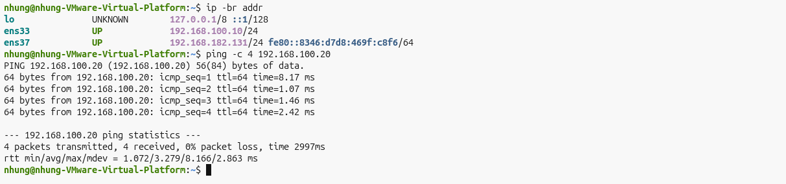

> **Hướng dẫn người đọc:** README này mô tả mục tiêu, môi trường, thứ tự tái lập và cách kiểm tra kết quả. Hãy đọc phần môi trường và lệnh trước khi chạy script; cập nhật IP/interface theo lab của bạn. Chỉ chạy trong mạng ảo được phép.

# KB01 – Phát hiện hành vi dò quét cổng TCP (TCP SYN Scan) trên máy chủ nội bộ

| Mục | Nội dung |
|---|---|
| Người thực hiện | Thư |
| Nhóm kịch bản | KB01–KB05: Trinh sát |
| Thời gian thực nghiệm | 01–02/11/2026 |
| Trạng thái | Đã hoàn thành: tạo lưu lượng, Run 1, Run 2, kiểm thử lưu lượng bình thường |
| Kết luận nhanh | ET Open mặc định **không phát hiện** (0/5). Luật nhóm SID 9000101 **phát hiện 5/5**, **0 cảnh báo sai** trên 12 PCAP bình thường, độ trễ trung bình **≈ 0,32 giây** |

---

## Phần I – Xây dựng bài toán

### 1. Bối cảnh thực tế

Một doanh nghiệp sử dụng máy chủ nội bộ để lưu trữ dữ liệu khách hàng, quản lý nhân sự và vận hành các ứng dụng phục vụ công việc hằng ngày.

Giả sử một thiết bị trong mạng nội bộ bị kẻ tấn công kiểm soát. Trước khi tìm cách khai thác máy chủ, kẻ tấn công thực hiện dò quét các cổng TCP để xác định những dịch vụ mạng đang được mở.

### 2. Vấn đề bảo mật

Kẻ tấn công sử dụng Nmap với kỹ thuật TCP SYN Scan để gửi các gói SYN đến nhiều cổng trên máy chủ mục tiêu. Đây có thể là bước trinh sát trước khi thực hiện các hành vi xâm nhập tiếp theo. Nếu không được phát hiện, quản trị viên có thể bỏ lỡ dấu hiệu hoạt động bất thường trong mạng.

### 3. Bài toán cần giải quyết

Xây dựng phương pháp giám sát và phát hiện hành vi TCP SYN Scan bằng Suricata IDS. Hệ thống cần nhận diện được dấu hiệu một thiết bị gửi liên tiếp các gói TCP SYN đến nhiều cổng khác nhau của máy chủ trong khoảng thời gian ngắn, đồng thời phân biệt được hành vi dò quét với lưu lượng TCP hợp lệ để hạn chế cảnh báo sai.

### 4. Mục tiêu thực nghiệm

- Mô phỏng TCP SYN Scan đối với máy chủ nội bộ bằng Nmap.
- Thu thập lưu lượng bằng tcpdump và lưu dưới dạng PCAP.
- Kiểm tra khả năng phát hiện của bộ luật Suricata có sẵn (ET Open).
- Nếu bộ luật có sẵn chưa đạt, bổ sung luật và kiểm thử lại trên cùng PCAP.
- Kiểm thử với lưu lượng bình thường để đánh giá cảnh báo sai.

### 5. Phương pháp giải quyết

Quy trình thực hiện gồm 4 bước:

1. **Xây dựng bài toán:** xác định hành vi cần phát hiện và tiêu chí đạt.
2. **Tạo lưu lượng và thu PCAP** trong VMware.
3. **Run 1:** chạy Suricata với bộ luật ET Open có sẵn. Nếu đạt thì giữ luật chung, không viết luật mới. Nếu chưa đạt thì bổ sung luật riêng và chạy **Run 2** trên đúng các PCAP đó.
4. **Đánh giá và viết báo cáo:** kết quả, hạn chế, minh chứng và kết luận.

### 6. Tiêu chí đánh giá (đặt trước khi chạy Suricata)

Bộ luật được coi là **đạt** khi thỏa mãn đồng thời:

1. Có cảnh báo liên quan đến quét cổng ở **cả 5 lần quét**, kể cả lần quét chậm (`-T2`) và lần quét ít cổng (11 cổng).
2. Cảnh báo ghi đúng **IP nguồn 192.168.100.10** (Attacker) và **IP đích 192.168.100.20** (Victim).
3. **Không có cảnh báo quét cổng** trên 12 PCAP lưu lượng bình thường.

Số lượng cảnh báo **không** được dùng làm tiêu chí so sánh, vì luật có thể giới hạn số lần cảnh báo bằng `threshold`.

---

## Phần II – Môi trường thực nghiệm

### 1. Cấu hình

| Thành phần | Cấu hình |
|---|---|
| Phần mềm ảo hóa | VMware Workstation |
| Máy Attacker | Ubuntu – `ens33`: **192.168.100.10/24** |
| Máy Victim | Ubuntu – `ens33`: **192.168.100.20/24** |
| Card mạng phụ (cả 2 máy) | `ens37`: mạng NAT 192.168.182.0/24, chỉ dùng để ra Internet |
| Công cụ dò quét | Nmap 7.98 |
| Công cụ bắt gói | tcpdump (chạy trên Victim, lọc `host 192.168.100.10` trên `ens33`) |
| IDS | Suricata **8.0.3** |
| Bộ luật Run 1 | ET Open, `/var/lib/suricata/rules/suricata.rules`, cập nhật 18/10/2026, **53 202 luật đang bật** |
| `HOME_NET` | `[192.168.100.0/24]` |
| `EXTERNAL_NET` | `!$HOME_NET` |
| Chế độ chạy Suricata | Đọc PCAP ngoại tuyến (`suricata -r`), tùy chọn `-k none` |

### 2. Kiểm tra IP và kết nối

Máy Attacker có IP 192.168.100.10 trên `ens33` và ping thành công đến Victim (4/4 gói, mất 0%).


*Hình 1. Attacker: `ip -br addr` và `ping` tới Victim. Ảnh chụp ngày 31/10, trong buổi chuẩn bị môi trường.*


*Hình 2. Attacker: `ip route`. Mạng lab 192.168.100.0/24 đi qua `ens33`.*


*Hình 3. Victim: `ip -br addr`, `ip route`, `systemctl is-active suricata`, và `suricata -T` cho bộ luật Run 1 và Run 2.*

### 3. Kiểm tra Suricata và bộ luật

Kết quả `suricata -T` cho thấy cả hai cấu hình đều nạp thành công ("Configuration provided was successfully loaded"):

- Run 1: `-S /var/lib/suricata/rules/suricata.rules` (chỉ ET Open)
- Run 2: `-S /tmp/run2.rules` (ET Open + `custom-rule.rules`)

**Lưu ý:** dịch vụ `suricata` chạy nền (systemd) trên Victim đang ở trạng thái `failed`. Toàn bộ kiểm thử trong kịch bản này dùng chế độ đọc PCAP ngoại tuyến (`suricata -r`), gọi trực tiếp chương trình Suricata và **không phụ thuộc** vào dịch vụ này. Lỗi dịch vụ đã được báo cho thành viên phụ trách cài đặt Suricata.


*Hình 4. Phiên bản Suricata, file luật ET Open, số luật đang bật (53 202), số luật ET SCAN đang bật (274) và bị tắt (46).*

---

## Phần III – Tạo lưu lượng và thu PCAP

### 1. Cách thực hiện

Mỗi lần quét gồm 3 bước:
1. Trên Victim, chạy tcpdump và chờ dòng "listening on ens33".
2. Trên Attacker, chạy nmap.
3. tcpdump tự dừng sau số giây đặt trong `timeout`.

```bash
# Victim
sudo timeout <giây> tcpdump -i ens33 -nn -s 0 -Z $USER -w ~/kb_pcaps/kb01_runN.pcap host 192.168.100.10
# Attacker
sudo nmap -sS <tốc độ> -p <dải cổng> 192.168.100.20 -oN kb01_runN.txt
```

Lệnh chi tiết của từng lần chạy nằm trong [`lenh_attacker_victim.txt`](lenh_attacker_victim.txt).

### 2. Năm lần quét

Lần **run2** dùng đúng lệnh trong `attack.sh` gốc (`nmap -sS -p 1-1000`). Bốn lần còn lại thay đổi tốc độ và dải cổng.

| Lần | Lệnh nmap | Số cổng | Số gói | Gói SYN | Thời gian quét | Cổng mở |
|---|---|---|---|---|---|---|
| run1 | `-sS -T2 -p 1-100` | 100 | 209 | 100 | 41,09 s | 22 |
| run2 | `-sS -T3 -p 1-1000` | 1 000 | 2 005 | 1 000 | 0,71 s | 22 |
| run3 | `-sS -T4 -p 1-1000` | 1 000 | 2 005 | 1 000 | 0,71 s | 22 |
| run4 | `-sS -T4 -p 1-65535` | 65 535 | 131 076 | 65 535 | 4,25 s | 22, 8000 |
| run5 | `-sS -T3 -p 21,22,23,25,53,80,110,143,443,3306,8080` | 11 | 27 | 11 | 0,63 s | 22 |

Ghi chú:
- Cổng 8000 trong run4 là web server phục vụ lưu lượng bình thường, đang chạy trên Victim.
- File PCAP dài khoảng 5–6 giây dù nmap chỉ quét dưới 1 giây, vì tcpdump được bật trước và tắt sau thời điểm quét.
- Trong mạng LAN ảo, `-T3` và `-T4` cho kết quả gần như giống nhau. Sự khác biệt về tốc độ chỉ thể hiện rõ ở run1 (`-T2`).
- Đã kiểm tra trực tiếp PCAP: 100% gói SYN do Attacker gửi đều có **TCP window = 1024** (tổng 67 646 gói). Trong lưu lượng bình thường từ curl, giá trị window là 64240.

### 3. Minh chứng từng lần quét

**run1:** `-T2`, 100 cổng


*Hình 5. run1: nmap trên Attacker; tcpdump bắt được 209 gói, trong đó 100 SYN.*

**run2:** `-T3`, 1–1000 (lệnh `attack.sh` gốc)


*Hình 6. run2: nmap quét 1000 cổng trong 0,71 s; tcpdump bắt được 2005 gói, trong đó 1000 SYN.*

**run3:** `-T4`, 1–1000


*Hình 7. run3: nmap `-T4`; tcpdump bắt được 2005 gói, trong đó 1000 SYN.*

**run4:** `-T4`, toàn bộ 65 535 cổng


*Hình 8. run4: quét 65 535 cổng trong 4,25 s, phát hiện cổng 22 và 8000 mở; tcpdump bắt được 131 076 gói, trong đó 65 535 SYN.*

**run5:** `-T3`, 11 cổng dịch vụ phổ biến


*Hình 9. run5: quét 11 cổng; tcpdump bắt được 27 gói, trong đó 11 SYN.*


*Hình 10. Danh sách 17 PCAP đã thu: 5 PCAP tấn công và 12 PCAP lưu lượng bình thường.*

### 4. Lưu lượng bình thường

Bộ 12 PCAP `benign_01.pcap` … `benign_12.pcap` dùng chung cho KB01–KB05. Bộ này **không chứa nmap**, gồm ping, truy cập web (có trang 404), tải file 20 MB qua HTTP, truy vấn DNS, SSH đúng mật khẩu, SCP và các kiểu kết hợp. Lệnh tạo từng file nằm trong `lenh_benign.txt`.

`benign_12` được thiết kế riêng để thử cảnh báo sai: 3 đợt × 40 request curl liên tục, tạo ra **120 gói SYN hợp lệ** vào cổng 8000 trong thời gian ngắn.

Ba file `benign_08`, `benign_11`, `benign_12` có thời lượng lưu lượng thực tế lần lượt khoảng 39, 55 và 52 giây, ngắn hơn mức 1–2 phút yêu cầu, vì lệnh tạo lưu lượng kết thúc sớm. Ba file vẫn được giữ lại vì có giá trị kiểm thử: SCP file lớn, kết hợp DNS và tải file, và nhiều SYN hợp lệ.

---

## Phần IV – Run 1: ET Open mặc định

### 1. Kiểm tra trước khi chạy

Trước khi chạy, các luật ET Open liên quan đến Nmap được kiểm tra:

- Các luật **đang bật** chỉ nhắm vào hoạt động khác của Nmap như NSE, User-Agent, quét SIP, OS detection, SQL spider. **Không có luật nào cho `-sS` thuần.**
- Các luật dành cho SYN scan **đang bị tắt** (dòng bắt đầu bằng `#`): `ET SCAN NMAP -sS window 1024` (SID 2009582), `window 2048` (2000537), `window 3072` (2009583), `window 4096` (2009584).


*Hình 11. HOME_NET và danh sách luật ET SCAN liên quan đến Nmap đang bật.*


*Hình 12. Danh sách luật ET SCAN liên quan đến Nmap đang bị tắt, gồm các luật `-sS window ...`.*

Nội dung luật SID 2009582:

```
# alert tcp $EXTERNAL_NET any -> $HOME_NET any (msg:"ET SCAN NMAP -sS window 1024"; fragbits:!D; dsize:0; flags:S,12; ack:0; window:1024; threshold: type both, track by_dst, count 1, seconds 60; classtype:attempted-recon; sid:2009582; rev:3; ...)
```


*Hình 13. `EXTERNAL_NET: "!$HOME_NET"` và luật SID 2009582 đang bị tắt.*

### 2. Lệnh chạy

```bash
RULES=/var/lib/suricata/rules/suricata.rules
for f in kb01_run*.pcap benign_*.pcap; do
  n=${f%.pcap}; mkdir -p out/run1/$n
  sudo suricata -c /etc/suricata/suricata.yaml -k none -S $RULES -r $f -l out/run1/$n
done
```

Tùy chọn `-S` chỉ nạp đúng file luật được chỉ định, nên Run 1 chỉ dùng ET Open và không nạp luật của nhóm.

### 3. Kết quả

| PCAP | Tổng cảnh báo | Cảnh báo liên quan quét cổng | Cảnh báo khác |
|---|---|---|---|
| kb01_run1 | 1 | **0** | SID 2200074 `SURICATA TCPv4 invalid checksum` (.20 → .10) |
| kb01_run2 | 1 | **0** | SID 2200074 |
| kb01_run3 | 1 | **0** | SID 2200074 |
| kb01_run4 | 2 | **0** | SID 2200074 |
| kb01_run5 | 1 | **0** | SID 2200074 |


*Hình 14. Run 1: kết quả trên 5 PCAP tấn công. Chỉ có cảnh báo checksum.*

Cảnh báo SID 2200074 **không phải phát hiện quét cổng**. Nó xuất hiện vì PCAP được bắt ngay trên Victim: card mạng tính checksum cho gói đi ra bằng phần cứng (checksum offload), nên tcpdump ghi lại checksum chưa hoàn chỉnh. Số cảnh báo này khớp với số gói SYN-ACK mà Victim trả về cho cổng mở (1 ở các lần quét, 2 ở run4 vì có 2 cổng mở).

### 4. Phân tích

**Run 1 phát hiện 0/5 lần quét, nên không đạt tiêu chí.** Có hai nguyên nhân độc lập:

1. **Luật SYN scan bị tắt mặc định** trong ET Open.
2. **Luật chỉ áp dụng chiều `$EXTERNAL_NET → $HOME_NET`.** Attacker (192.168.100.10) nằm trong `HOME_NET` (192.168.100.0/24), nên không khớp `EXTERNAL_NET = !$HOME_NET`. Kể cả khi bật luật lên, bối cảnh "thiết bị nội bộ bị chiếm quyền quét máy chủ" vẫn không được phát hiện.

Phần dấu hiệu của luật thì đúng: các gói SYN của nmap có `window = 1024`, đúng như luật 2009582 mô tả.

**→ Luật chung chưa đạt. Cần bổ sung luật riêng và chạy Run 2.**

---

## Phần V – Run 2: ET Open + luật nhóm

### 1. Luật bổ sung (`custom-rule.rules`)

```
alert tcp any any -> $HOME_NET any (msg:"KB01 Nmap SYN scan (window 1024) - nguon bat ky"; flags:S,12; ack:0; window:1024; dsize:0; threshold: type both, track by_src, count 5, seconds 60; classtype:attempted-recon; sid:9000101; rev:1;)
```

| Thành phần | Ý nghĩa |
|---|---|
| `any any -> $HOME_NET any` | Nhận gói từ **mọi nguồn**, kể cả thiết bị nội bộ, khắc phục nguyên nhân 2 ở Run 1 |
| `flags:S,12; ack:0; dsize:0` | Gói chỉ có cờ SYN, ACK = 0, không có dữ liệu |
| `window:1024` | Giá trị window mặc định của gói SYN do nmap tạo, đã kiểm chứng trên PCAP |
| `threshold: type both, track by_src, count 5, seconds 60` | Chỉ cảnh báo khi một nguồn gửi từ 5 gói như vậy trong 60 giây, và tối đa 1 cảnh báo mỗi 60 giây cho mỗi nguồn. Ngưỡng 5 được chọn để vẫn bắt được run5 (chỉ 11 SYN) |
| `sid:9000101` | SID riêng của nhóm |

Luật được lưu trong thư mục kịch bản. File `rules/local.rules` dùng chung **không bị sửa**.

### 2. Lệnh chạy

```bash
cat $RULES custom-rule.rules > /tmp/run2.rules
sudo suricata -T -c /etc/suricata/suricata.yaml -S /tmp/run2.rules    # nạp thành công (Hình 3)
for f in kb01_run*.pcap benign_*.pcap; do
  n=${f%.pcap}; mkdir -p out/run2/$n
  sudo suricata -c /etc/suricata/suricata.yaml -k none -S /tmp/run2.rules -r $f -l out/run2/$n
done
```

Run 2 dùng **đúng 17 PCAP** của Run 1. Cấu hình `suricata.yaml` và tùy chọn chạy giữ nguyên; chỉ khác bộ luật.

### 3. Kết quả

| PCAP | Cảnh báo SID 9000101 | Thời điểm | Nguồn → Đích |
|---|---|---|---|
| kb01_run1 (`-T2`, 100 cổng) | **1** | 01/11/2026 16:11:02 | 192.168.100.10 → 192.168.100.20 |
| kb01_run2 (`-T3`, 1000 cổng) | **1** | 01/11/2026 16:15:49 | 192.168.100.10 → 192.168.100.20 |
| kb01_run3 (`-T4`, 1000 cổng) | **1** | 01/11/2026 16:17:42 | 192.168.100.10 → 192.168.100.20 |
| kb01_run4 (`-T4`, 65535 cổng) | **1** | 01/11/2026 16:21:45 | 192.168.100.10 → 192.168.100.20 |
| kb01_run5 (`-T3`, 11 cổng) | **1** | 01/11/2026 16:19:36 | 192.168.100.10 → 192.168.100.20 |


*Hình 15. Run 2: mỗi PCAP tấn công có 1 cảnh báo SID 9000101; các PCAP bình thường không có (đã ẩn cảnh báo checksum để dễ đọc).*


*Hình 16. Thời điểm, IP nguồn và IP đích của 5 cảnh báo SID 9000101.*

Mỗi lần quét chỉ sinh **1 cảnh báo**, kể cả run4 với 65 535 gói SYN, do `threshold` giới hạn 1 cảnh báo mỗi 60 giây cho mỗi nguồn. Vì vậy **số cảnh báo không phản ánh quy mô cuộc quét**. Muốn biết quy mô cần xem PCAP hoặc log flow.

### 4. Độ trễ phát hiện

Độ trễ được tính từ **gói SYN đầu tiên** do Attacker gửi trong PCAP đến **cảnh báo 9000101**.

| PCAP | Gói SYN đầu tiên | Cảnh báo 9000101 | Độ trễ |
|---|---|---|---|
| kb01_run1 (`-T2`) | 16:11:00.678 | 16:11:02.281 | 1,60 s |
| kb01_run2 (`-T3`) | 16:15:49.032 | 16:15:49.036 | 0,003 s |
| kb01_run3 (`-T4`) | 16:17:42.390 | 16:17:42.390 | < 0,001 s |
| kb01_run4 (`-T4`, 65 535 cổng) | 16:21:45.672 | 16:21:45.672 | < 0,001 s |
| kb01_run5 (11 cổng) | 16:19:36.998 | 16:19:36.998 | < 0,001 s |
| **Trung bình** | | | **≈ 0,32 s** |


*Hình 16b. Gói SYN đầu tiên và thời điểm cảnh báo 9000101 của 5 lần quét (ngày 01/11/2026, đồng hồ Victim). Lệnh đo được chạy ngày 04/11/2026 trên các PCAP và kết quả Run 2 đã lưu.*

Luật cần 5 gói SYN có window 1024 trong 60 giây. Ở tốc độ T3/T4, nmap gửi đủ 5 gói gần như tức thì. Riêng run1 dùng `-T2` (nmap chờ khoảng 0,4 giây giữa các gói), nên mất khoảng 1,6 giây mới đủ ngưỡng.

---

## Phần VI – Kiểm tra cảnh báo trên lưu lượng bình thường

12 PCAP bình thường được chạy với **cả hai cấu hình** Run 1 và Run 2.

| PCAP | Nội dung | Tổng cảnh báo (Run 1 = Run 2) | Cảnh báo quét cổng Run 1 | Cảnh báo SID 9000101 Run 2 | Cảnh báo khác |
|---|---|---|---|---|---|
| benign_01 | ping 90 gói | 0 | 0 | 0 | – |
| benign_02 | ping 1000 byte | 0 | 0 | 0 | – |
| benign_03 | web 30 lần | 177 | 0 | 0 | 2034636 ×29, checksum |
| benign_04 | web ngẫu nhiên, có 404 | 147 | 0 | 0 | 2034636 ×24, checksum |
| benign_05 | tải file 20 MB qua HTTP | 512 | 0 | 0 | 2034636 ×16, checksum |
| benign_06 | 20 truy vấn DNS | 20 | 0 | 0 | checksum UDP |
| benign_07 | SSH đúng mật khẩu | 24 | 0 | 0 | checksum |
| benign_08 | SCP 2 lượt | 554 | 0 | 0 | checksum |
| benign_09 | ping / web / DNS | 72 | 0 | 0 | 2034636 ×11, checksum |
| benign_10 | web + SSH | 95 | 0 | 0 | 2034636 ×12, checksum |
| benign_11 | DNS + tải file | 457 | 0 | 0 | 2034636 ×11, checksum |
| benign_12 | 120 request curl dồn dập | 721 | 0 | **0** | 2034636 ×120, checksum |


*Hình 17. Run 1: cảnh báo trên các PCAP bình thường. Chỉ có cảnh báo checksum và SID 2034636.*

Nhận xét:
- **Không có cảnh báo quét cổng nào** trên lưu lượng bình thường, ở cả Run 1 và Run 2. Kể cả `benign_12`, với 120 SYN hợp lệ trong thời gian ngắn, cũng không bị luật 9000101 cảnh báo, vì gói SYN của curl có window 64240 chứ không phải 1024.
- Tổng số cảnh báo trên từng file bình thường **giống hệt nhau** giữa Run 1 và Run 2, nên luật nhóm không sinh thêm cảnh báo nào trên lưu lượng bình thường.
- SID 2034636 `ET INFO Python SimpleHTTP ServerBanner` là luật mang tính **thông tin**, báo có web server Python. Điều này đúng thực tế, vì Victim chạy `python3 -m http.server 8000`. Đây không phải cảnh báo sai về hành vi quét.
- SID 2200074/2200075 là lỗi checksum do checksum offload, cùng nguyên nhân như ở Phần IV.

---

## Phần VII – So sánh và đánh giá

| Tiêu chí | Run 1 (ET Open) | Run 2 (ET Open + SID 9000101) |
|---|---|---|
| Phát hiện 5 lần quét | **0/5** | **5/5** |
| Phát hiện quét chậm `-T2` (run1) | Không | Có |
| Phát hiện quét ít cổng (run5, 11 SYN) | Không | Có |
| Đúng IP nguồn và đích | – | Đúng cả 5 |
| Cảnh báo quét cổng trên 12 PCAP bình thường | 0 | **0** |
| Độ trễ trung bình | – | ≈ 0,32 s |
| **Kết luận theo tiêu chí** | **Chưa đạt** | **Đạt** |

Run 2 đạt vì luật mới **phù hợp với hành vi mục tiêu**: bắt đúng dấu hiệu của gói SYN do nmap tạo và áp dụng cho cả nguồn nội bộ. Kết luận không dựa vào việc Run 2 có nhiều cảnh báo hơn.

---

## Phần VIII – Hạn chế

1. **Luật phụ thuộc vào dấu hiệu `window 1024`**, giá trị mặc định khi nmap gửi gói SYN. Công cụ quét khác, hoặc nmap đã được tùy biến, có thể dùng giá trị khác và không bị phát hiện. Luật này nhận diện **nmap -sS mặc định**, chưa phải mọi kiểu quét cổng.
2. **Bộ lưu lượng bình thường còn hạn chế:** chỉ gồm ping, curl, dig, ssh, scp từ một máy. Chưa kiểm tra được trường hợp phần mềm hợp lệ nào đó cũng gửi SYN với window 1024.
3. **Môi trường nhỏ:** chỉ có 2 máy trong một mạng LAN ảo; Suricata chạy ngoại tuyến trên PCAP, chưa kiểm thử ở chế độ giám sát trực tiếp. Dịch vụ suricata (systemd) trên Victim đang `failed`.
4. **`threshold`** khiến mỗi lần quét chỉ có 1 cảnh báo, không thể hiện số cổng bị quét.
5. **`HOME_NET` gồm toàn bộ dải 192.168.100.0/24**, nên Attacker và Victim cùng nằm trong vùng được bảo vệ. Đây chính là lý do luật ET Open không áp dụng được (Phần IV).
6. Ba PCAP bình thường (`benign_08`, `benign_11`, `benign_12`) ngắn hơn 1 phút.
7. `-T3` và `-T4` cho kết quả gần như giống nhau trong mạng ảo, nên mức độ đa dạng về tốc độ quét còn hạn chế.

---

## Phần IX – Kết luận

- Bộ luật ET Open mặc định **không phát hiện** TCP SYN Scan xuất phát từ thiết bị nội bộ (0/5), vì luật SYN scan bị tắt và chỉ áp dụng cho nguồn bên ngoài `HOME_NET`.
- Luật bổ sung **SID 9000101** dựa trên dấu hiệu `window 1024` đã được kiểm chứng trên PCAP, áp dụng cho mọi nguồn. Luật **phát hiện 5/5** lần quét ở các tốc độ (`-T2`, `-T3`, `-T4`) và dải cổng khác nhau (11 đến 65 535 cổng), đúng IP nguồn và đích, và **không sinh cảnh báo sai** trên 12 PCAP lưu lượng bình thường.
- Kết luận chỉ có giá trị trong phạm vi môi trường và dữ liệu đã kiểm thử, với các hạn chế nêu ở Phần VIII.

---

## Danh sách file trong thư mục

| File | Nội dung |
|---|---|
| `README.md` | Báo cáo kịch bản (file này) |
| `attack.sh` | Lệnh tấn công gốc của kịch bản |
| `lenh_attacker_victim.txt` | Lệnh thực tế đã chạy: bắt PCAP, Suricata Run 1/Run 2, trích bằng chứng |
| `custom-rule.rules` | Luật nhóm SID 9000101 |
| `kb01_run1.pcap` … `kb01_run5.pcap` | 5 PCAP tấn công (run2 tương ứng `attack.sh` gốc) |
| `eve-excerpt-run1.json` | Run 1: toàn bộ cảnh báo trên 5 PCAP tấn công (6 dòng, đều là checksum) |
| `eve-excerpt-run2.json` | Run 2: 5 cảnh báo SID 9000101 |
| `benign-eve-excerpt-run1.json` | Run 1: cảnh báo trên 12 PCAP bình thường, **đã lọc bỏ** checksum 2200074/2200075 (223 dòng, đều là SID 2034636) |
| `benign-eve-excerpt-run2.json` | Run 2: tương tự, 223 dòng, đều là SID 2034636 |
| `summary-run1.txt`, `summary-run2.txt` | Bảng tóm tắt cảnh báo theo từng PCAP |
| `screenshots/` | Ảnh minh chứng |


*Hình 18. Số dòng các file trích sự kiện trước khi nộp.*


## Tệp nguồn và minh chứng gốc

Thư mục nguồn trong repository ban đầu: [`01-nmap-syn-scan`](https://github.com/phanyen206/Suricata/tree/main/scenarios/01-nmap-syn-scan). Các tệp nhị phân như PCAP, ảnh chụp và tài liệu DOCX (nếu có) hiện vẫn được giữ tại repository nguồn; README này liên kết về nguồn để người đọc tải/xem, không thay thế bằng dữ liệu giả.
