# KB05 – Phát hiện dò hệ điều hành, phiên bản dịch vụ và script NSE của nmap (nmap -O -sV --script)

| Mục | Nội dung |
|---|---|
| Người thực hiện | Thư |
| Nhóm kịch bản | KB01–KB05: Trinh sát |
| ATT&CK | T1046 – Network Service Discovery (chính); T1595 – Active Scanning (liên quan, áp dụng khi quét từ bên ngoài) |
| Công cụ | nmap 7.98 |
| SID liên quan | ET Open **2024364** (có sẵn, phát hiện được), **2018489**, **2009358**, **2009359** (có sẵn, không khớp); luật nhóm **9000501** (lưu trong `custom-rule.rules`) |
| Thời gian thực nghiệm | 04/11/2026 |
| Trạng thái | Đã hoàn thành: tạo lưu lượng, Run 1, Run 2, kiểm thử lưu lượng bình thường |
| Kết luận nhanh | ET Open **4/5** (bỏ sót lần dò hệ điều hành thuần). ET Open + luật nhóm **5/5**, **0 cảnh báo sai**, độ trễ trung bình **≈ 5,4 giây** |

---

## Phần I – Xây dựng bài toán

### 1. Bối cảnh

Sau khi biết máy chủ có những cổng nào mở (KB01–KB04), kẻ tấn công cần biết thêm **máy chủ chạy hệ điều hành gì** và **dịch vụ nào, phiên bản bao nhiêu**, để tìm lỗ hổng tương ứng. Nmap cung cấp ba kỹ thuật cho việc này:

| Tùy chọn | Kỹ thuật | Lưu lượng sinh ra |
|---|---|---|
| `-O` | Dò hệ điều hành (OS fingerprinting) | Một loạt gói TCP, ICMP và UDP đặc biệt; trong đó có gói UDP mang 300 byte chữ `C` |
| `-sV` | Dò phiên bản dịch vụ | Kết nối vào cổng mở, gửi các yêu cầu thăm dò, đọc banner |
| `--script` | Chạy script NSE (ở đây là `http-title`) | Yêu cầu HTTP có User-Agent của nmap |

### 2. Vấn đề bảo mật

Thông tin thu được rất chi tiết. Trong thực nghiệm này, nmap lấy được chính xác **OpenSSH 10.2p1 Ubuntu**, **dnsmasq 2.92**, **SimpleHTTPServer 0.6 / Python 3.14.4**, và xác định hệ điều hành là Linux. Đây là bước chuẩn bị trực tiếp cho giai đoạn khai thác.

### 3. Bài toán

Dùng Suricata IDS phát hiện cả ba kỹ thuật, dùng riêng lẻ hay kết hợp, từ một thiết bị nội bộ, và không cảnh báo nhầm với lưu lượng web, SSH, DNS bình thường.

### 4. Tiêu chí đánh giá (giống KB01–KB04)

Bộ luật được coi là **đạt** khi thỏa mãn đồng thời:
1. Có cảnh báo liên quan đến nmap hoặc trinh sát ở **cả 5 lần quét**, gồm cả các lần chỉ dùng một kỹ thuật.
2. Cảnh báo có đúng **IP nguồn 192.168.100.10** và **IP đích 192.168.100.20**.
3. **Không có cảnh báo trinh sát** trên 12 PCAP lưu lượng bình thường.

Cảnh báo chung của bộ giải mã gói (decoder), không chỉ ra nmap hay hành vi trinh sát, **không** được tính là phát hiện. Số lượng cảnh báo không được dùng làm tiêu chí so sánh.

### 5. Quy trình

Giống các kịch bản trước: xây dựng bài toán → tạo lưu lượng và thu PCAP → Run 1 với ET Open. Nếu chưa đạt thì bổ sung luật riêng và chạy Run 2 trên đúng các PCAP đó → đánh giá và viết báo cáo.

---

## Phần II – Môi trường thực nghiệm

| Thành phần | Cấu hình |
|---|---|
| Máy Attacker | Ubuntu, `Ubuntu-Attacker`, `ens33`: **192.168.100.10/24** |
| Máy Victim | Ubuntu, `Ubuntu-Victim`, `ens33`: **192.168.100.20/24** |
| Dịch vụ trên Victim | 22 (OpenSSH), 53 (dnsmasq), 8000 (python http.server) |
| IDS | Suricata **8.0.3**, chạy đọc PCAP ngoại tuyến (`suricata -r`, `-k none`) |
| Bộ luật Run 1 | ET Open, giống các kịch bản trước |
| `HOME_NET` / `EXTERNAL_NET` | `[192.168.100.0/24]` / `!$HOME_NET` |
| Bắt gói | tcpdump trên Victim, `host 192.168.100.10`, dừng bằng Ctrl+C |

Mọi thời điểm trong báo cáo lấy theo **đồng hồ Victim**.

---

## Phần III – Tạo lưu lượng và thu PCAP

### 1. Cách thực hiện

```bash
# Victim – bật trước, dừng bằng Ctrl+C khoảng 5 giây sau khi nmap kết thúc
sudo tcpdump -i ens33 -nn -s 0 -Z $USER -w ~/kb_pcaps/kb05_runN.pcap host 192.168.100.10
# Attacker
sudo nmap <kỹ thuật> 192.168.100.20 -oN kb05_runN.txt
```

Lần 1 chạy đúng `attack.sh`. Bốn lần còn lại **tách riêng từng kỹ thuật** để xác định luật nào bắt được kỹ thuật nào. Lệnh chi tiết nằm trong [`lenh_attacker_victim.txt`](lenh_attacker_victim.txt).

### 2. Năm lần quét

| Lần | Lệnh nmap | Kỹ thuật | Thời gian | SYN | UDP | UDP 300 byte | `Nmap Scripting Engine` | pcap |
|---|---|---|---|---|---|---|---|---|
| run1 (`attack.sh`) | `-O -sV --script http-title` | OS + dịch vụ + NSE | 21,54 s | 1047 | 5 | **5** | **5** | 181K |
| run2 | `-O` | chỉ OS | 12,06 s | 1035 | 5 | **5** | 0 | 166K |
| run3 | `-sV -p 22,53,8000` | chỉ dịch vụ | 7,83 s | 14 | 0 | 0 | **4** | 15K |
| run4 | `-A -T4` | OS + dịch vụ + script mặc định + traceroute | 27,21 s | 1084 | 6 | **5** | **29** | 248K |
| run5 | `-p 8000 --script http-title` | chỉ NSE | 0,72 s | 2 | 0 | 0 | **1** | 1.9K |

Nhận xét:
- **Gói UDP 300 byte** (toàn chữ `C`) chỉ xuất hiện khi có `-O`. Mỗi lần dò hệ điều hành gửi 5 gói, vì nmap thử lại khi không tìm được hệ điều hành khớp chính xác.
- **User-Agent `Nmap Scripting Engine`** xuất hiện ở **mọi lần có `-sV` hoặc `--script`**. Đáng chú ý là run3 **không chạy `--script`** nhưng vẫn có 4 request mang User-Agent này. Lý do là `-sV` tự động gọi thêm một số script NSE để nhận diện dịch vụ HTTP. Như vậy, chỉ cần dò phiên bản dịch vụ web là nmap đã tự để lộ dấu vết.
- `-A` (run4) sinh nhiều lưu lượng nhất: 29 request NSE, thêm script `dns-nsid` (đọc được `bind.version: dnsmasq-2.92`), `http-server-header` và traceroute.
- Mọi lần quét đều có **ít nhất một** trong hai dấu hiệu (UDP 300 byte hoặc User-Agent NSE).

### 3. Minh chứng từng lần quét

**run1:** `-O -sV --script http-title`, đúng `attack.sh`

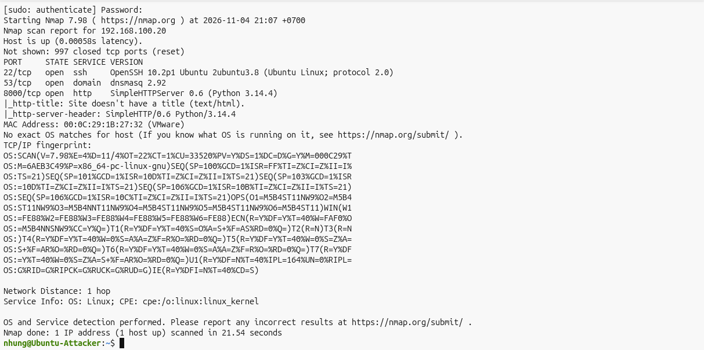
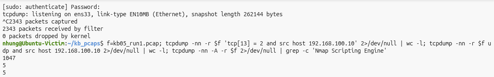
*Hình 1. run1: nmap nhận diện đầy đủ phiên bản dịch vụ và in TCP/IP fingerprint; PCAP có 1047 SYN, 5 UDP, 5 request NSE.*

**run2:** chỉ `-O`

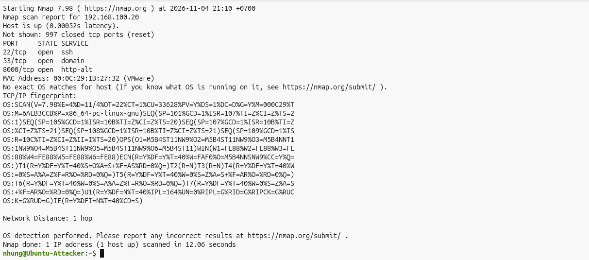
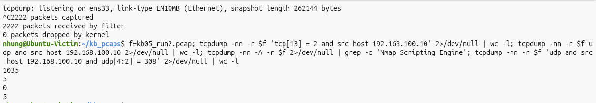
*Hình 2. run2: chỉ dò hệ điều hành; có 5 gói UDP 300 byte, không có request NSE.*

**run3:** chỉ `-sV`

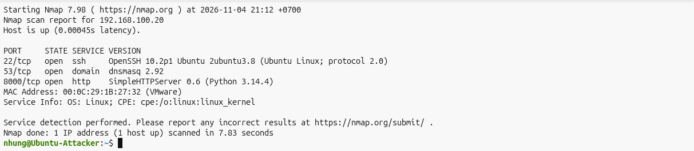
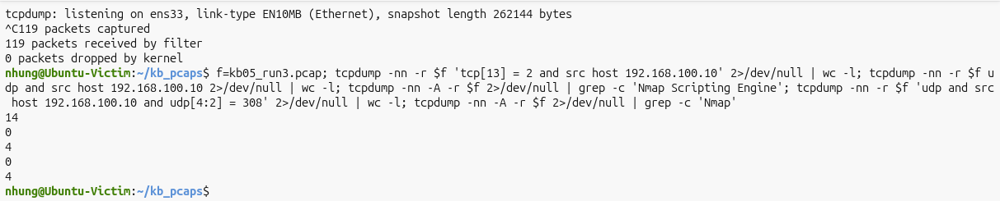
*Hình 3. run3: chỉ dò phiên bản trên 3 cổng; vẫn có 4 request mang User-Agent NSE.*

**run4:** `-A -T4`

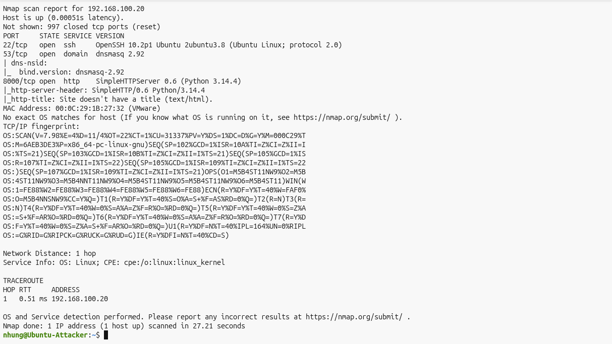
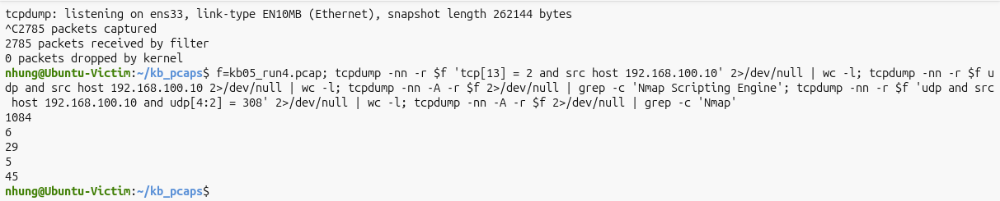
*Hình 4. run4: chế độ aggressive; 29 request NSE, 5 gói UDP 300 byte, có traceroute.*

**run5:** chỉ script NSE trên cổng 8000

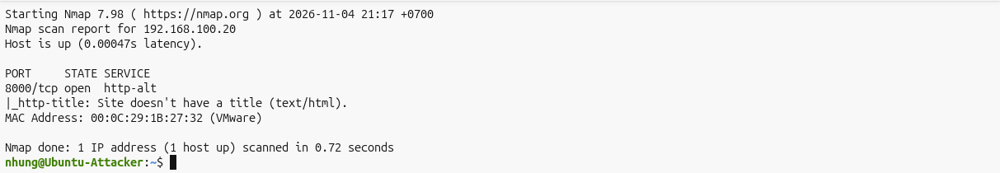
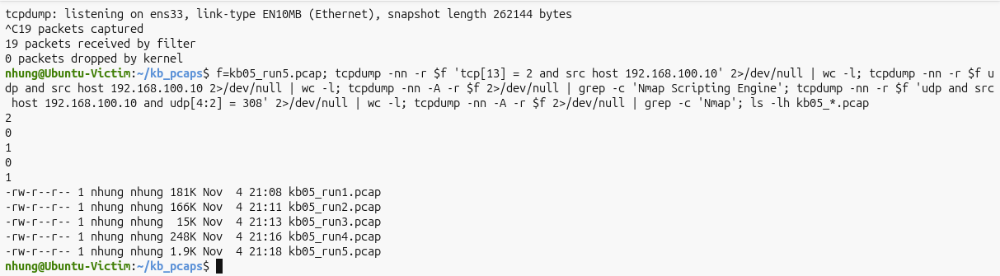
*Hình 5. run5: 0,72 s, chỉ 19 gói và 1 request NSE. Kèm danh sách 5 PCAP KB05.*

### 4. Lưu lượng bình thường

KB05 dùng chung bộ 12 PCAP `benign_01` … `benign_12` với KB01 (xem README và `lenh_benign.txt` của KB01). Trong đó có nhiều request HTTP bằng `curl` tới cùng web server cổng 8000, SSH, SCP và DNS, tức là đúng các dịch vụ mà nmap thăm dò trong kịch bản này.

---

## Phần IV – Run 1: ET Open mặc định

### 1. Kiểm tra trước khi chạy

```
alert udp  $EXTERNAL_NET 10000: -> $HOME_NET 10000: (msg:"ET SCAN NMAP OS Detection Probe"; dsize:300; content:"CCCC..."; ... sid:2018489; ...)
alert http $EXTERNAL_NET any -> $HOME_NET any (msg:"ET SCAN Nmap Scripting Engine User-Agent Detected (Nmap NSE)"; ... content:"Nmap NSE"; ... sid:2009359; ...)
alert http $HOME_NET any -> any any (msg:"ET SCAN Possible Nmap User-Agent Observed"; ... http.user_agent; content:"|20|Nmap"; ... sid:2024364; ...)
alert http $EXTERNAL_NET any -> $HOME_NET any (msg:"ET SCAN Nmap Scripting Engine User-Agent Detected (Nmap Scripting Engine)"; ... sid:2009358; ...)
```

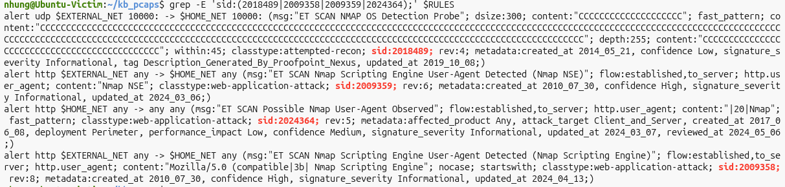
*Hình 6. Bốn luật ET Open liên quan đến nmap OS detection và NSE. Cả 4 luật đều đang bật.*

| SID | Nhắm vào | Chiều áp dụng | Áp dụng được cho Attacker nội bộ? |
|---|---|---|---|
| 2018489 | Gói dò OS UDP 300 byte chữ `C` | `$EXTERNAL_NET 10000: → $HOME_NET 10000:` | **Không** |
| 2009359 | User-Agent `Nmap NSE` | `$EXTERNAL_NET → $HOME_NET` | **Không** |
| 2009358 | User-Agent `Mozilla/5.0 (compatible; Nmap Scripting Engine…` | `$EXTERNAL_NET → $HOME_NET` | **Không** |
| **2024364** | User-Agent chứa `" Nmap"` | **`$HOME_NET → any`** | **Có**, vì nguồn là `HOME_NET` |

Đây là kịch bản đầu tiên trong nhóm trinh sát mà ET Open có **một luật không bị giới hạn bởi `$EXTERNAL_NET`**.

### 2. Lệnh chạy và kết quả

```bash
for f in kb05_run*.pcap; do
  n=${f%.pcap}; mkdir -p out_kb05/run1/$n
  sudo suricata -c /etc/suricata/suricata.yaml -k none -S $RULES -r $f -l out_kb05/run1/$n
done
```

| PCAP | Kỹ thuật | **2024364** (.10 → .20) | 2200025 `ICMPv4 unknown code` | Cảnh báo khác | Phát hiện? |
|---|---|---|---|---|---|
| run1 | OS + dịch vụ + NSE | **5** | 5 + 5 | 9 × 2034636, 95 × checksum | ✅ |
| run2 | chỉ OS | **0** | 5 + 5 | 38 × checksum | ❌ |
| run3 | chỉ dịch vụ | **4** | – | 8 × 2034636, 51 × checksum | ✅ |
| run4 | `-A` | **29** | 5 + 5 | 36 × 2034636, 262 × checksum, 1 × 2260002 | ✅ |
| run5 | chỉ NSE | **1** | – | 1 × 2034636, 7 × checksum | ✅ |

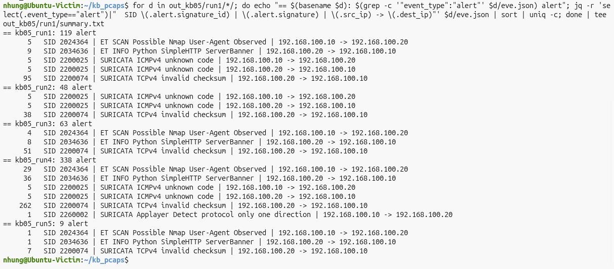
*Hình 7. Run 1 trên 5 PCAP KB05.*

Run 1 trên lưu lượng bình thường **dùng lại kết quả KB01**, vì cấu hình giữ nguyên.

### 3. Phân tích

- **2024364 phát hiện 4/5**, gồm mọi lần quét có gửi User-Agent của nmap. Số cảnh báo đúng bằng số request có User-Agent đó (5 / 4 / 29 / 1), vì luật **không có `threshold`**. Run4 có tới 29 cảnh báo, tức là luật khá "ồn".
- **run2 (chỉ `-O`) không có cảnh báo trinh sát nào.** Luật dành cho gói dò OS (2018489) có sẵn và đang bật, nhưng chỉ áp dụng cho nguồn bên ngoài nên không khớp.
- **2200025 `SURICATA ICMPv4 unknown code`** xuất hiện ở các lần có `-O`, theo cả hai chiều. Đây là cảnh báo của bộ giải mã gói. Một trong các gói dò OS của nmap là ping mang mã ICMP bất thường, và gói trả lời của Victim cũng mang mã đó. Cảnh báo này chỉ báo "gói bất thường" chung chung, không chỉ ra nmap hay hành vi trinh sát, nên theo tiêu chí **không được tính là phát hiện**.
- 2260002 (`Applayer Detect protocol only one direction`, 1 lần ở run4) và các cảnh báo checksum, banner không liên quan đến hành vi trinh sát.

**→ Run 1 chưa đạt (4/5). Lỗ hổng nằm ở trường hợp chỉ dò hệ điều hành.**

---

## Phần V – Run 2: ET Open + luật nhóm

### 1. Dữ liệu dùng để thiết kế luật

| PCAP | Gói UDP 300 byte (`udp[4:2] = 308`) | `Nmap Scripting Engine` | `Nmap` |
|---|---|---|---|
| run1 | **5** | 5 | 5 |
| run2 | **5** | 0 | 0 |
| run3 | 0 | 4 | 4 |
| run4 | **5** | 29 | 45 |
| run5 | 0 | 1 | 1 |
| 12 file benign | **0** | **0** | **0** |

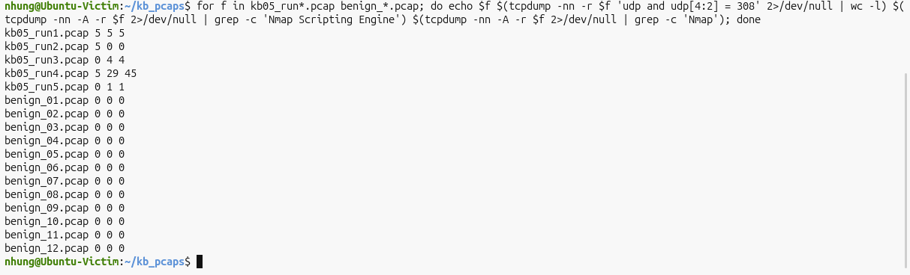
*Hình 8. Số gói UDP 300 byte và số lần xuất hiện chuỗi `Nmap` trên 17 PCAP.*

Hai dấu hiệu phủ kín cả 5 lần quét, và lưu lượng bình thường không có dấu hiệu nào. Dấu hiệu User-Agent đã được luật ET Open 2024364 xử lý tốt, nên chỉ cần bổ sung **một luật** cho gói dò hệ điều hành.

### 2. Luật bổ sung (`custom-rule.rules`)

```
alert udp any any -> $HOME_NET any (msg:"KB05 Nmap OS detection - goi UDP 300 byte chu C"; dsize:300; content:"CCCCCCCCCCCCCCCCCCCCCCCCCCCCCC"; fast_pattern; threshold: type limit, track by_src, count 1, seconds 60; classtype:attempted-recon; sid:9000501; rev:1;)
```

| Thành phần | So với 2018489 | Ý nghĩa |
|---|---|---|
| `udp any any -> $HOME_NET any` | 2018489 dùng `$EXTERNAL_NET 10000: -> $HOME_NET 10000:` | Áp dụng cho **mọi nguồn** và **mọi cổng** |
| `dsize:300; content:"CCC…"` (30 ký tự `C`) | Cùng dấu hiệu | Gói dò OS của nmap: 300 byte dữ liệu toàn chữ `C` |
| `threshold: type limit, track by_src, count 1, seconds 60` | 2018489 không có | Cảnh báo ngay từ gói đầu tiên, tối đa 1 lần mỗi 60 giây cho mỗi nguồn, để tránh kêu 5 lần cho một lần quét |

Luật nhóm **không thay thế** 2024364 mà **bổ sung** cho nó: 2024364 bắt phần dò dịch vụ và NSE, còn 9000501 bắt phần dò hệ điều hành.

### 3. Lệnh chạy

```bash
cat $RULES custom-rule-kb05.rules > /tmp/run2_kb05.rules
sudo suricata -T -c /etc/suricata/suricata.yaml -S /tmp/run2_kb05.rules     # successfully loaded
for f in kb05_run*.pcap benign_*.pcap; do
  n=${f%.pcap}; mkdir -p out_kb05/run2/$n
  sudo suricata -c /etc/suricata/suricata.yaml -k none -S /tmp/run2_kb05.rules -r $f -l out_kb05/run2/$n
done
```

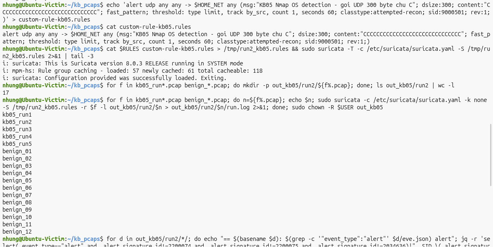
*Hình 9. Tạo `custom-rule-kb05.rules`, kiểm tra cú pháp (`successfully loaded`) và chạy Run 2 trên 17 PCAP.*

### 4. Kết quả

| PCAP | Kỹ thuật | 2024364 (ET Open) | **9000501** (luật nhóm) | Phát hiện |
|---|---|---|---|---|
| run1 | OS + dịch vụ + NSE | 5 | **1** | ✅ |
| run2 | chỉ OS | – | **1** | ✅ (**chỉ nhờ luật nhóm**) |
| run3 | chỉ dịch vụ | 4 | – | ✅ |
| run4 | `-A` | 29 | **1** | ✅ |
| run5 | chỉ NSE | 1 | – | ✅ |

Tất cả cảnh báo 2024364 và 9000501 đều có chiều **192.168.100.10 → 192.168.100.20**.

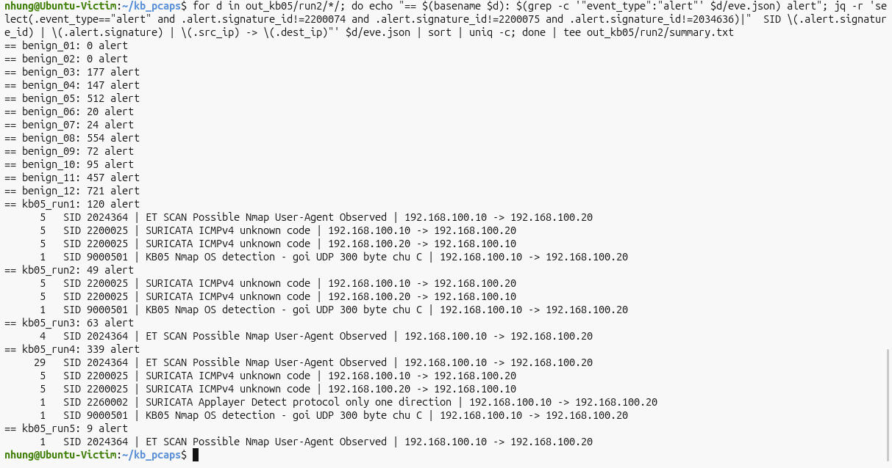
*Hình 10. Run 2 trên 12 PCAP bình thường và 5 PCAP KB05 (đã ẩn cảnh báo checksum và banner).*

- **5/5** lần quét bị phát hiện, so với **4/5** ở Run 1.
- Tổng cảnh báo của mỗi PCAP KB05 chỉ tăng **đúng 1** so với Run 1 ở các lần có `-O` (119 → 120, 48 → 49, 338 → 339). Như vậy luật nhóm không làm thay đổi gì khác.
- Khi cả hai luật cùng kêu (run1, run4), cảnh báo cho biết nmap đã dùng **cả dò hệ điều hành lẫn dò dịch vụ / NSE**.

### 5. Độ trễ phát hiện

Độ trễ được tính từ **gói IP đầu tiên** do Attacker gửi đến **cảnh báo sớm nhất** của 2024364 hoặc 9000501.

| PCAP | Gói đầu tiên | 2024364 sớm nhất | 9000501 sớm nhất | Độ trễ |
|---|---|---|---|---|
| run1 | 21:07:56.743 | 21:08:15.597 | **21:08:04.918** | 8,18 s |
| run2 | 21:10:13.731 | – | **21:10:18.732** | 5,00 s |
| run3 | 21:13:04.257 | **21:13:11.090** | – | 6,83 s |
| run4 | 21:14:39.426 | 21:14:57.088 | **21:14:46.453** | 7,03 s |
| run5 | 21:17:52.784 | **21:17:52.799** | – | 0,02 s |
| **Trung bình** | | | | **≈ 5,41 s** |

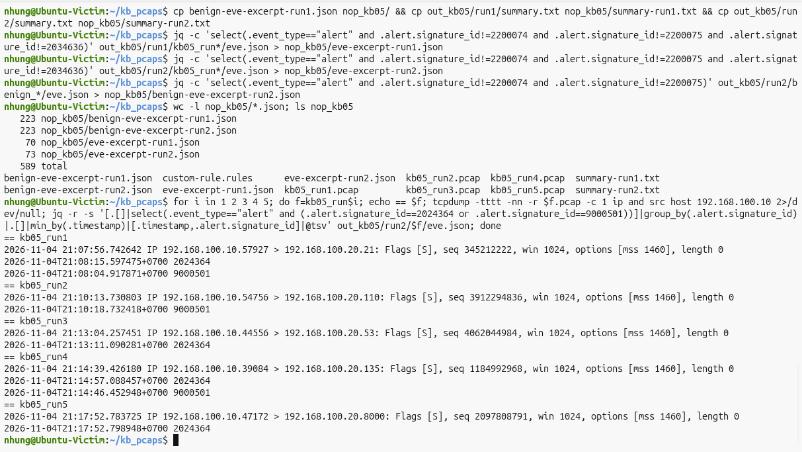
*Hình 11. Số dòng các file trích sự kiện, gói đầu tiên của Attacker (gói SYN, `win 1024`) và thời điểm cảnh báo sớm nhất của từng luật (ngày 04/11/2026, đồng hồ Victim).*

Độ trễ lớn hơn KB01–KB04, vì nmap luôn **quét cổng trước** (giai đoạn này chỉ có gói SYN) rồi mới dò hệ điều hành và dịch vụ. Hai luật của KB05 chỉ kích hoạt ở giai đoạn sau. Run5 chỉ quét 1 cổng rồi chạy script ngay, nên gần như không có độ trễ. Giai đoạn quét SYN ban đầu có thể được phát hiện sớm hơn nhờ luật SYN scan của KB01 (SID 9000101), nhưng kịch bản này **chưa kiểm thử** việc kết hợp hai luật.

---

## Phần VI – Kiểm tra cảnh báo trên lưu lượng bình thường

| PCAP | Tổng cảnh báo Run 2 | 2024364 | 9000501 | Ghi chú |
|---|---|---|---|---|
| benign_01, benign_02 (ping) | 0 | 0 | 0 | |
| benign_03 → benign_05 (web curl, tải file) | 177 / 147 / 512 | **0** | **0** | Cùng web server cổng 8000 mà nmap thăm dò |
| benign_06 (DNS, UDP) | 20 | 0 | **0** | UDP hợp lệ, không có gói 300 byte chữ `C` |
| benign_07, benign_08 (SSH, SCP) | 24 / 554 | 0 | 0 | |
| benign_09 → benign_11 (kết hợp) | 72 / 95 / 457 | **0** | **0** | |
| benign_12 (120 request curl) | 721 | **0** | 0 | User-Agent của curl không chứa `Nmap` |

- **Không có cảnh báo 2024364 hay 9000501** trên 12 PCAP bình thường, kể cả hàng trăm request HTTP và truy vấn DNS tới đúng các dịch vụ bị nmap thăm dò.
- Tổng số cảnh báo trên từng file **bằng đúng Run 1** (KB01).

---

## Phần VII – So sánh và đánh giá

| Tiêu chí | Run 1 (ET Open) | Run 2 (ET Open + 9000501) |
|---|---|---|
| Phát hiện 5 lần quét | **4/5** | **5/5** |
| Phát hiện dò hệ điều hành thuần (`-O`) | Không | Có |
| Phát hiện dò dịch vụ / NSE | Có (2024364) | Có (2024364) |
| Đúng IP nguồn / đích | Đúng | Đúng cả 5 |
| Cảnh báo sai trên 12 PCAP bình thường | 0 | **0** |
| Độ trễ trung bình | – | ≈ 5,41 s |
| **Kết luận theo tiêu chí** | **Chưa đạt** | **Đạt** |

Khác với KB01–KB04, ở KB05 ET Open đã làm được phần lớn công việc nhờ luật 2024364. Luật nhóm chỉ **lấp một lỗ hổng cụ thể** (dò hệ điều hành) chứ không phải viết lại toàn bộ.

---

## Phần VIII – Hạn chế

1. **Cả hai luật dựa vào dấu hiệu mặc định của nmap.** Kẻ tấn công có thể đổi User-Agent (`--script-args http.useragent=...`) để tránh 2024364. Gói dò OS 300 byte chữ `C` là cố định trong nmap nhưng không áp dụng cho công cụ dò OS khác. Luật nhận diện **nmap**, không phải mọi kỹ thuật dò hệ điều hành hoặc dịch vụ.
2. **2024364 không có `threshold`** nên rất ồn (29 cảnh báo cho một lần `-A`). Luật này là luật có sẵn của ET Open, và nhóm không chỉnh sửa luật có sẵn.
3. **Độ trễ trung bình khoảng 5,4 giây**, vì cả hai luật chỉ kích hoạt sau giai đoạn quét cổng. Chưa kiểm thử việc kết hợp với luật SYN scan của KB01 để phát hiện sớm hơn.
4. **Cảnh báo 2200025 (ICMPv4 unknown code)** có xuất hiện khi dò OS, nhưng không được tính vì không chỉ rõ hành vi. Đánh giá này phụ thuộc vào tiêu chí đã đặt ở Phần I.4.
5. **Bộ lưu lượng bình thường** chưa có công cụ quản trị hợp lệ dùng nmap (ví dụ quét kiểm kê định kỳ), hay ứng dụng khác gửi User-Agent chứa chữ "Nmap". Trong môi trường thật, các trường hợp này sẽ sinh cảnh báo cần phân loại.
6. Môi trường chỉ có 2 máy ảo; Suricata chạy ngoại tuyến. Run 1 trên lưu lượng bình thường dùng lại kết quả KB01.

---

## Phần IX – Kết luận

- ET Open mặc định phát hiện được **4/5** lần quét nhờ luật **2024364** (User-Agent nmap), luật duy nhất trong nhóm áp dụng cho nguồn nội bộ. ET Open **bỏ sót lần chỉ dò hệ điều hành**: luật dành cho gói dò OS (2018489) có sẵn và đang bật nhưng chỉ áp dụng cho nguồn bên ngoài.
- Bổ sung một luật nhóm **9000501**, có cùng dấu hiệu với 2018489 nhưng áp dụng cho mọi nguồn và có giới hạn số cảnh báo, đã nâng kết quả lên **5/5**, với **độ trễ trung bình khoảng 5,4 giây** và **không có cảnh báo sai** trên 12 PCAP lưu lượng bình thường.
- Kết luận chỉ có giá trị trong phạm vi môi trường và dữ liệu đã kiểm thử, với các hạn chế nêu ở Phần VIII.

---

## Danh sách file trong thư mục

| File | Nội dung |
|---|---|
| `README.md` | Báo cáo kịch bản (file này) |
| `attack.sh` | Lệnh tấn công gốc (`nmap -O -sV --script http-title`) |
| `lenh_attacker_victim.txt` | Lệnh thực tế đã chạy và số liệu từng lần quét |
| `custom-rule.rules` | Luật nhóm SID 9000501 |
| `kb05_run1.pcap` … `kb05_run5.pcap` | 5 PCAP tấn công (run1 tương ứng `attack.sh`) |
| `eve-excerpt-run1.json` | Run 1: cảnh báo trên 5 PCAP, đã lọc checksum và banner (70 dòng: 39 × 2024364, 30 × 2200025, 1 × 2260002) |
| `eve-excerpt-run2.json` | Run 2: như trên, thêm 3 × 9000501 (73 dòng) |
| `benign-eve-excerpt-run1.json` | Run 1 trên lưu lượng bình thường, dùng lại từ KB01 (223 dòng, đều là SID 2034636) |
| `benign-eve-excerpt-run2.json` | Run 2 trên lưu lượng bình thường, đã lọc checksum (223 dòng, đều là SID 2034636) |
| `summary-run1.txt`, `summary-run2.txt` | Bảng tóm tắt cảnh báo |
| `screenshots/` | Ảnh minh chứng |
