> **Hướng dẫn người đọc:** README này mô tả mục tiêu, môi trường, thứ tự tái lập và cách kiểm tra kết quả. Hãy đọc phần môi trường và lệnh trước khi chạy script; cập nhật IP/interface theo lab của bạn. Chỉ chạy trong mạng ảo được phép.

# KỊCH BẢN 8 – PHÁT HIỆN LƯU LƯỢNG ICMP FLOOD BẰNG SURICATA

> **Phiên bản báo cáo:** thực nghiệm trên mạng Host-only của nhóm (`192.168.100.10 → 192.168.100.20`), kết quả **0 – 73 – 0 – 0**.  
> **Công cụ:** Suricata 8.0.3; phân tích PCAP ngoại tuyến.  
> **Phạm vi khẳng định:** đánh giá cảnh báo trước mẫu ICMP Echo Request tần suất cao, **không** chứng minh hệ thống bị từ chối dịch vụ hoặc luật phát hiện mọi dạng ICMP Flood.

> **Hình minh họa:** đã cắt gọn vùng lệnh/kết quả quan trọng và trình bày nền trắng. Các ảnh PNG đặt cùng thư mục với `README.md` để liên kết ảnh không cần tiền tố `images/`.

## 1. Tổng quan và mục tiêu

ICMP Echo Request (ICMP type 8) thường dùng để kiểm tra kết nối mạng. Nếu một nguồn phát sinh nhiều gói Echo Request trong thời gian ngắn, lưu lượng này có thể là dấu hiệu bất thường cần giám sát. Một luật chỉ dựa trên ICMP type 8 sẽ cảnh báo cả ping bình thường; trong khi đó, bộ luật đối chứng được nạp từ cấu hình Suricata có thể không phát cảnh báo đối với mẫu thử nghiệm cụ thể.

Mục tiêu kịch bản:

1. Thiết lập kết nối mạng riêng giữa Attacker và Victim đúng địa chỉ IP của nhóm.
2. Tạo và lưu hai mẫu dữ liệu: ICMP tần suất cao (`sample_group.pcap`) và ping thông thường (`normal_group.pcap`).
3. So sánh số cảnh báo giữa bộ luật đối chứng được cấu hình trên Victim và luật riêng `SID 1000006`, `rev:2` trên **cùng một PCAP**.
4. Chỉ ra giới hạn của phép thử, ghi lại bằng chứng nguồn luật và hướng cải tiến.

## 2. Bài toán xây dựng luật riêng

**Tên bài toán:** Xây dựng và kiểm thử luật phát hiện ICMP Echo Request tần suất cao dựa trên ngưỡng theo từng IP nguồn bằng Suricata, đồng thời hạn chế cảnh báo trên mẫu ping thông thường.

**Vấn đề cần giải quyết:** Trong thực nghiệm đối chứng, Suricata không sinh cảnh báo trên mẫu ICMP tần suất cao. Luật tự viết ban đầu (`rev:1`) khớp tất cả Echo Request, vì vậy chưa phân biệt được ping thường và lưu lượng có tần suất cao. Luật cải tiến (`rev:2`) sử dụng `detection_filter` để điều kiện hóa việc phát cảnh báo theo tần suất.

**Đầu vào:** Gói ICMP Echo Request trong PCAP, địa chỉ nguồn và thời điểm xuất hiện của từng gói.  
**Đầu ra:** Các bản ghi `event_type="alert"`, `alert.signature_id=1000006` trong `eve.json`.

Gọi `N(s, Δt)` là số lần khớp luật từ một IP nguồn `s` trong cửa sổ `Δt = 1 giây`; ngưỡng thực nghiệm `T = 20`. Mô hình đơn giản:

```text
N(s, 1 giây) > 20  → cơ chế detection_filter cho phép phát cảnh báo
N(s, 1 giây) ≤ 20  → không phát cảnh báo theo điều kiện ngưỡng
```

> Đây là mô hình giải thích cơ chế phát hiện, không phải quy tắc kết luận chắc chắn một cuộc tấn công DoS. Một nguồn có thể tạo nhiều bản ghi cảnh báo sau khi vượt ngưỡng; **số cảnh báo ≠ số cuộc tấn công**. Ngưỡng 20/giây là lựa chọn thực nghiệm, chưa được tối ưu hóa cho mạng thực tế.

### 2.1. Luật cơ sở – rev:1 (minh họa cách thiết kế)

```suricata
alert icmp any any -> any any (msg:"LAB DOS ICMP flood"; itype:8; classtype:attempted-dos; sid:1000006; rev:1;)
```

Luật này khớp mọi Echo Request, bất kể tần suất, nên có nguy cơ cảnh báo không mong muốn đối với ping thường.

### 2.2. Luật cải tiến – rev:2 (sử dụng trong 4 Run)

```suricata
alert icmp any any -> any any (msg:"LAB DOS ICMP flood"; itype:8; detection_filter:track by_src, count 20, seconds 1; classtype:attempted-dos; sid:1000006; rev:2;)
```

| Tùy chọn | Ý nghĩa |
|---|---|
| `alert icmp` | Xét và phát sự kiện cảnh báo đối với giao thức ICMP |
| `itype:8` | Chỉ khớp ICMP Echo Request |
| `track by_src` | Theo dõi ngưỡng theo từng địa chỉ IP nguồn |
| `count 20, seconds 1` | Ngưỡng 20 lần khớp trong cửa sổ 1 giây |
| `classtype:attempted-dos` | Phân loại cảnh báo có dấu hiệu DoS |
| `sid:1000006; rev:2` | Mã luật và phiên bản cải tiến |

## 3. Môi trường thực nghiệm và địa chỉ IP của nhóm

| Thành phần | Card NAT – truy cập Internet | Card mạng lab – Host-only VMnet1 |
|---|---|---|
| Attacker (Ubuntu) | `ens33: NAT` | `ens37: 192.168.100.10/24` |
| Victim (Ubuntu, chạy Suricata) | `ens33: NAT` | `ens37: 192.168.100.20/24` |
| Mạng | VMnet8 – NAT | VMnet1 – `192.168.100.0/24` |

IP Host-only đã được đặt bằng cấu hình NetworkManager `ipv4.method manual`, `connection.autoconnect yes`, **không cấu hình gateway mặc định trên ens37**. Kiểm tra hai chiều cho kết quả ping 4/4 gói, mất gói 0%.

**Lệnh xác minh trên mỗi máy:**

```bash
ip -br addr
nmcli -f ipv4.method,ipv4.addresses,ipv4.gateway,connection.autoconnect con show ens37
```

**Trên Attacker:**

```bash
ping -c 4 -I 192.168.100.10 192.168.100.20
```

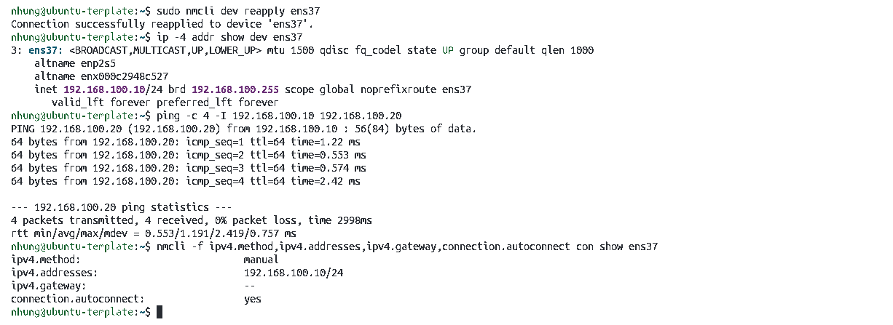

*Hình 1. Attacker đặt `192.168.100.10/24` trên ens37 và ping tới Victim thành công (0% packet loss).*

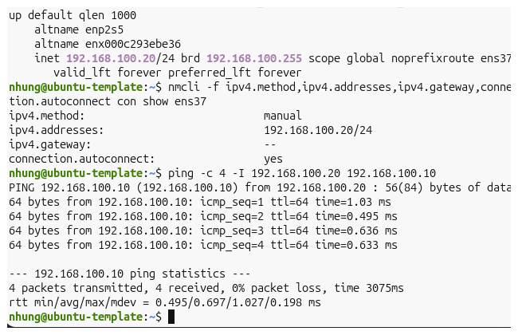

*Hình 2. Victim đặt `192.168.100.20/24` trên ens37 và ping ngược đến Attacker thành công.*

## 4. Bộ luật đối chứng trên Victim – cách xác minh

**Không lấy `custom-rule.rules` trên GitHub làm bộ luật chung.** Trong các Run đối chứng, Suricata sử dụng `suricata.rules` đang cấu hình trên Victim, còn luật tự viết chỉ được nạp thêm ở Run 2 và Run 4 bằng tùy chọn `-s`.

Các kiểm tra đã thực hiện:

```bash
suricata-update --version
ls -lh /var/lib/suricata/rules/suricata.rules
grep '^default-rule-path:' /etc/suricata/suricata.yaml
grep -A 2 '^rule-files:' /etc/suricata/suricata.yaml
grep -nE 'sid:(1000006|1000010|1000015);' /var/lib/suricata/rules/suricata.rules
suricata-update list-enabled-sources
sudo suricata -T -v -c /etc/suricata/suricata.yaml
sha256sum /var/lib/suricata/rules/suricata.rules
```

**Bằng chứng quan sát trên Victim:**

- Suricata `8.0.3`; `suricata-update 1.3.7`.
- `default-rule-path: /var/lib/suricata/rules`; `rule-files: - suricata.rules`.
- File `suricata.rules` khoảng 44 MB; có các chữ ký bắt đầu bằng `ET`.
- Ba SID tùy chỉnh `1000006`, `1000010`, `1000015` không xuất hiện trong lần tìm kiếm ở file đối chứng.
- Kết quả kiểm tra cấu hình: **53.307 rules successfully loaded; 0 failed; 0 skipped**.
- `suricata-update list-enabled-sources` báo `No enabled sources` (không có nguồn *bổ sung* được bật; không đồng nghĩa file luật rỗng).
- Cache có tệp tên `*emerging.rules.tar.gz`; không khôi phục được lịch sử tải xuống đầy đủ chỉ bằng dữ liệu cache.

**Giới hạn xác minh nguồn:** Các dấu hiệu trên phù hợp với bộ luật Emerging Threats (ET) trên máy Victim và cơ chế mặc định của `suricata-update`, nhưng không đủ để chứng minh tuyệt đối nguồn gốc của từng chữ ký hoặc thời điểm tải. Không tự ý cập nhật luật giữa các lần đối chứng vì có thể thay đổi kết quả.

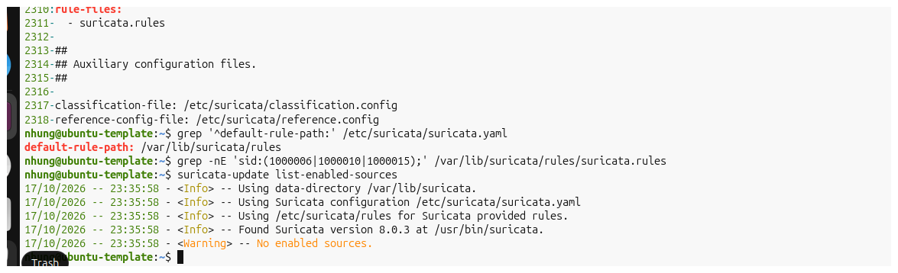

*Hình 3. `suricata.yaml` trỏ tới file `suricata.rules`, không có SID luật riêng trong file đối chứng.*

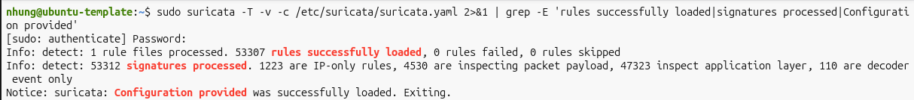

*Hình 4. Suricata nạp thành công 53.307 luật, không có luật lỗi hoặc bị bỏ qua.*

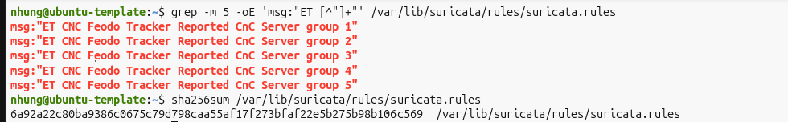

*Hình 5. Các chữ ký ET hiển thị trong file luật và việc tính SHA-256 để định danh bộ luật thử nghiệm.*

## 4.1. File mã nguồn và cách chạy

Các script đi kèm để thành viên nhóm có thể tái hiện phép thử. Chúng chỉ hoạt động trong lab IP `192.168.100.10 → 192.168.100.20` và **không** thay thế bộ luật ET Open đã cài trên Victim.

| Tệp | Chạy trên máy | Chức năng |
|---|---|---|
| `attack.sh` | Attacker | Tạo 100 ICMP Echo Request, cách nhau theo tham số 0,01 giây (đúng cách đã thực nghiệm) |
| `normal.sh` | Attacker | Tạo 5 ping với khoảng cách 1 giây |
| `capture.sh` | Victim | Thu các gói ICMP một chiều qua ens37 thành PCAP, không ghi đè PCAP cũ |
| `run-tests.sh` | Victim | Đọc hai PCAP và chạy 4 phép thử vào thư mục log mới, đếm cảnh báo |
| `custom-rule.rules` | Victim | Luật `rev:2` cho Run 2, Run 4 |
| `custom-rule-original.rules` | Victim | Luật `rev:1` minh họa, không dùng trong 4 Run chính |

**Trình tự dùng script:** Trên Victim chạy `./capture.sh sample_group.pcap` (để cửa sổ mở), trên Attacker chạy `./attack.sh`; sau đó dừng tcpdump bằng `Ctrl+C`. Tiếp tục tương tự với `./capture.sh normal_group.pcap` và `./normal.sh`. Sau khi hai PCAP đã có, trên Victim chạy `./run-tests.sh`. Nếu đã có PCAP của lần trước thì **không chạy lại capture.sh để ghi đè**; chỉ chạy script phân tích khi cần. Các file `.sh` đã được cấp quyền thực thi trong ZIP; nếu GitHub không giữ quyền này, dùng `bash attack.sh` hoặc `bash run-tests.sh`.

> `attack.sh` gốc của dự án trước đây dùng `hping3 --flood` trong 5 giây, **không phải** lệnh đã tạo mẫu PCAP 100 gói. Bản này cố ý dùng `ping -c 100 -i 0.01` để phù hợp thực nghiệm chính thức; không lấy kết quả của script gốc gán cho mẫu mới.

## 5. Chuẩn bị dữ liệu PCAP đúng IP nhóm

Thư mục trên **Victim**: `~/scenarios/10-icmp-flood`. Dữ liệu thu thập sử dụng thống nhất IP của nhóm.

### 5.1. Mẫu ICMP tần suất cao: `sample_group.pcap`

**Trên Victim (Terminal 1, mở cho đến khi thu xong):**

```bash
cd ~/scenarios/10-icmp-flood
sudo tcpdump -i ens37 -nn -w sample_group.pcap 'icmp and src host 192.168.100.10 and dst host 192.168.100.20'
```

**Trên Attacker (Terminal 2; chỉ chạy trong mạng lab được phép):**

```bash
ping -c 100 -i 0.01 -I 192.168.100.10 192.168.100.20
```

Dừng tcpdump trên Victim bằng `Ctrl+C`, sau đó kiểm tra:

```bash
tcpdump -nn -r sample_group.pcap -c 5
tcpdump -nn -r sample_group.pcap 'icmp[icmptype] == icmp-echo' 2>/dev/null | wc -l
```

**Đã quan sát:** file có 100 gói ICMP Echo Request từ `192.168.100.10` đến `192.168.100.20`. Đây là mẫu lưu lượng ICMP tần suất cao có giới hạn, không phải bằng chứng tài nguyên Victim đã bị cạn kiệt.

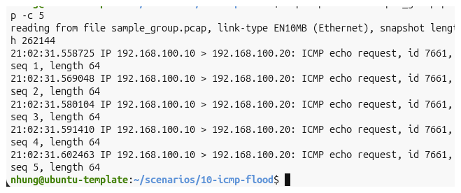

*Hình 6. `sample_group.pcap` thể hiện đúng IP nguồn và đích.*

### 5.2. Mẫu ping bình thường: `normal_group.pcap`

**Victim (Terminal 1):**

```bash
sudo tcpdump -i ens37 -nn -w normal_group.pcap 'icmp and src host 192.168.100.10 and dst host 192.168.100.20'
```

**Attacker (Terminal 2):**

```bash
ping -c 5 -i 1 -I 192.168.100.10 192.168.100.20
```

Dừng tcpdump, kiểm tra:

```bash
tcpdump -nn -r normal_group.pcap -c 5
```

**Đã quan sát:** 5 Echo Request với khoảng cách xấp xỉ 1 giây/gói.

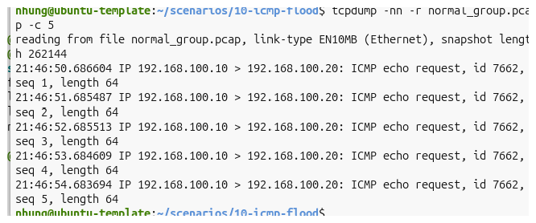

*Hình 7. `normal_group.pcap` có 5 Echo Request theo mô hình IP nhóm.*

## 6. Chạy thực nghiệm – 4 Run với hai PCAP nhóm

> Các lệnh thực hiện trên **Victim**, trong `~/scenarios/10-icmp-flood`. Sử dụng thư mục log mới và trống; nếu chạy lại, hãy thay tên thư mục đầu ra để tránh cộng dồn sự kiện trong `eve.json`.

### Run 1 – Mẫu tần suất cao với bộ luật đối chứng

```bash
cd ~/scenarios/10-icmp-flood
mkdir -p run1_group
sudo suricata -r sample_group.pcap -c /etc/suricata/suricata.yaml -l run1_group
jq -s '[.[] | select(.event_type=="alert")] | length' run1_group/eve.json
```

**Quan sát:** Suricata đọc **100 gói (9.800 bytes)**; kết quả **0 cảnh báo** với cấu hình luật đối chứng của máy Victim.

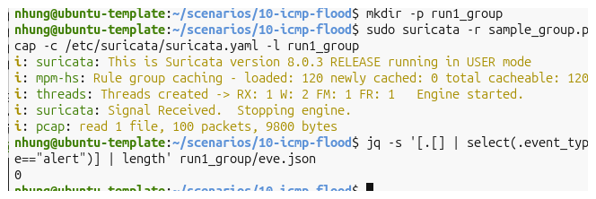

*Hình 8. Run 1 – 0 cảnh báo trên mẫu 100 gói ICMP.*

### Run 2 – Mẫu tần suất cao với luật riêng rev:2

```bash
cat custom-rule.rules
sudo suricata -T -c /etc/suricata/suricata.yaml -s custom-rule.rules
mkdir -p run2_group
sudo suricata -r sample_group.pcap -c /etc/suricata/suricata.yaml -s custom-rule.rules -l run2_group
grep -c '"signature_id":1000006' run2_group/eve.json
```

**Quan sát:** Suricata đọc **100 gói (9.800 bytes)**; luật riêng `SID 1000006` sinh **73 cảnh báo**.

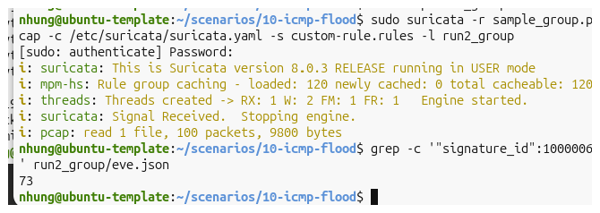

*Hình 9. Run 2 – 73 sự kiện cảnh báo theo luật riêng rev:2.*

### Run 3 – Mẫu ping bình thường với bộ luật đối chứng

```bash
mkdir -p run3_group
sudo suricata -r normal_group.pcap -c /etc/suricata/suricata.yaml -l run3_group
jq -s '[.[] | select(.event_type=="alert")] | length' run3_group/eve.json
```

**Quan sát:** Suricata đọc **5 gói (490 bytes)**; **0 cảnh báo**.

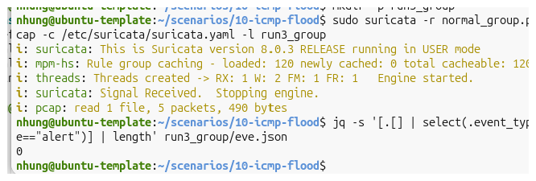

*Hình 10. Run 3 – 0 cảnh báo trên ping bình thường với luật đối chứng.*

### Run 4 – Mẫu ping bình thường với luật riêng rev:2

```bash
mkdir -p run4_group
sudo suricata -r normal_group.pcap -c /etc/suricata/suricata.yaml -s custom-rule.rules -l run4_group
grep -c '"signature_id":1000006' run4_group/eve.json
```

**Quan sát:** Suricata đọc **5 gói (490 bytes)**; **0 cảnh báo SID 1000006**.

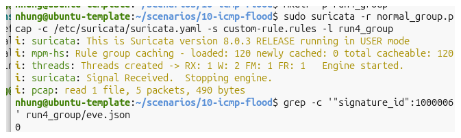

*Hình 11. Run 4 – 0 cảnh báo của luật riêng đối với mẫu ping thông thường.*

**Ghi chú kỹ thuật:** `grep -c` dùng để đếm các dòng EVE có SID tương ứng. Cách đếm dựa vào định dạng EVE JSON một sự kiện trên một dòng. Có thể dùng lệnh `jq -s` ở Run 1/3 để đếm một cách cấu trúc hơn.

## 7. Tổng hợp số liệu và đánh giá

| Run | Dữ liệu | Bộ luật | Gói đọc | Cảnh báo |
|---|---|---|---:|---:|
| **1** | `sample_group.pcap` | Cấu hình đối chứng (ET Open) | 100 | **0** |
| **2** | `sample_group.pcap` | Đối chứng + luật riêng rev:2 | 100 | **73** (SID 1000006) |
| **3** | `normal_group.pcap` | Cấu hình đối chứng (ET Open) | 5 | **0** |
| **4** | `normal_group.pcap` | Đối chứng + luật riêng rev:2 | 5 | **0** (SID 1000006) |

### 7.1. Diễn giải kết quả

- **Khả năng phát hiện mẫu tần suất cao:** Bộ luật đối chứng không phát sinh cảnh báo trên mẫu cụ thể này; luật riêng phát sinh 73 sự kiện khi tần suất ICMP vượt ngưỡng.
- **Tránh cảnh báo trên mẫu bình thường:** Cả hai cách chạy đều không phát cảnh báo trên mẫu 5 gói ping thông thường; riêng luật `rev:2` không kích hoạt SID 1000006.
- **Lợi ích của luật tùy chỉnh:** Bổ sung cơ chế giám sát lưu lượng ICMP Echo Request tần suất cao, không lệ thuộc vào chữ ký mã độc hay nội dung payload.
- **Không được suy diễn:** 73 sự kiện không có nghĩa 73 gói độc hại độc lập hoặc 73 cuộc tấn công; không thể suy ra precision, recall hay false-positive rate từ hai mẫu nhỏ.

### 7.2. Hạn chế thực nghiệm

1. Chỉ có hai mẫu ICMP và một mức ngưỡng; mẫu ping 5 gói chưa đại diện cho mọi lưu lượng bình thường.
2. Chưa đánh giá lưu lượng hỗn hợp, nhiều nguồn, kích thước gói khác nhau hay thay đổi tần suất.
3. PCAP được **phân tích offline**; chưa đánh giá tỷ lệ mất gói, độ trễ hoặc mức sử dụng CPU/RAM khi giám sát trực tiếp.
4. Đích được ping vẫn phản hồi; thực nghiệm không chứng minh thành công hành vi từ chối dịch vụ.
5. Để so sánh tuyệt đối nguồn luật, cần lưu bản `suricata.rules` hoặc mã SHA-256 cùng thời điểm chạy thử; ảnh hiện tại xác nhận cấu hình nhưng chưa khôi phục toàn bộ lịch sử nguồn tải.

### 7.3. Hướng phát triển

- Kiểm thử nhiều mức tần suất: 5, 10, 20, 50 và 100 gói/giây.
- Bổ sung mẫu bình thường có ping chẩn đoán liên tục, nhiều IP nguồn và hoạt động mạng đồng thời.
- So sánh hiệu quả của các ngưỡng và cách theo dõi `by_src`/`by_dst` trong môi trường lab.
- Ghi lại bộ luật đối chứng và thời điểm thử nghiệm để bảo đảm khả năng tái lập.

## 8. Cấu trúc file kèm theo

```text
10-icmp-flood/
├── README.md
├── custom-rule.rules               # luật dùng trong Run 2, 4 (rev:2)
├── custom-rule-original.rules      # minh họa phiên bản rev:1
├── attack.sh                       # Attacker: 100 gói Echo Request / 0,01 giây
├── normal.sh                       # Attacker: 5 gói ping bình thường
├── capture.sh                      # Victim: ghi PCAP theo IP nhóm
├── run-tests.sh                    # Victim: chạy Run 1–4, log tách biệt
├── *.png                           # hình minh họa cùng cấp README
├── sample_group.pcap               # tạo trên Victim; không kèm trong ZIP
├── normal_group.pcap               # tạo trên Victim; không kèm trong ZIP
├── run1_group/                     # log trên Victim; không kèm trong ZIP
├── run2_group/
├── run3_group/
└── run4_group/
```

> **Lưu ý:** ZIP gồm README, các script `.sh`, hai file luật và ảnh Terminal của thực nghiệm theo IP nhóm. Hai PCAP và các thư mục `run*_group` vẫn nằm trên máy Victim; không có trong ZIP.

## 9. Kết luận

Kịch bản 10 đã được kiểm thử lại theo mô hình mạng Host-only thống nhất của nhóm: **Attacker `192.168.100.10` → Victim `192.168.100.20`**. Trên mẫu ICMP tần suất cao 100 gói, bộ luật đối chứng không phát sinh cảnh báo, trong khi luật riêng `SID 1000006`, `rev:2` tạo 73 cảnh báo. Trên mẫu ping thông thường 5 gói, luật riêng không phát sinh cảnh báo. Kết quả cho thấy luật tùy chỉnh đáp ứng mục tiêu của bài thực hành trong phạm vi hai mẫu dữ liệu và là cơ sở cho việc nghiên cứu, hiệu chỉnh ngưỡng phát hiện sau này.


## Tệp nguồn và minh chứng gốc

Thư mục nguồn trong repository ban đầu: [`10-icmp-flood`](scenarios/10-icmp-flood). Các tệp nhị phân như PCAP, ảnh chụp, gói minh chứng hoặc tài liệu DOCX (nếu có) hiện vẫn được giữ tại repository nguồn; README này liên kết về nguồn để người đọc tải/xem, không thay thế bằng dữ liệu giả.
