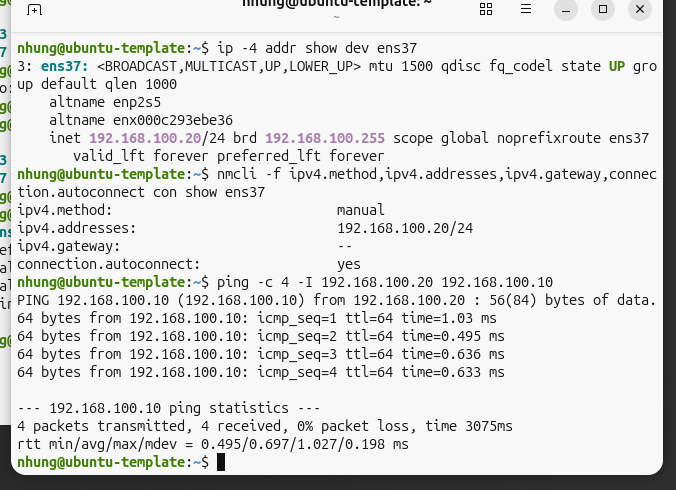
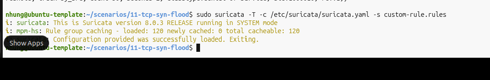
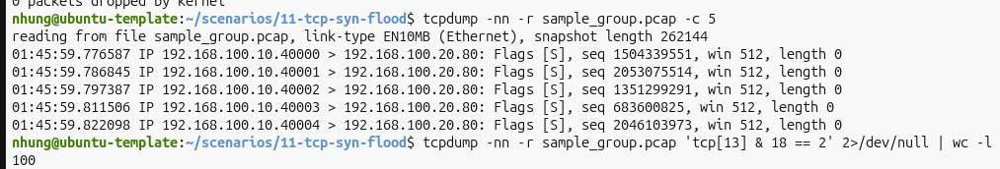
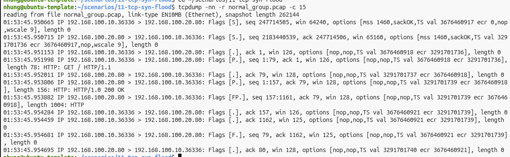
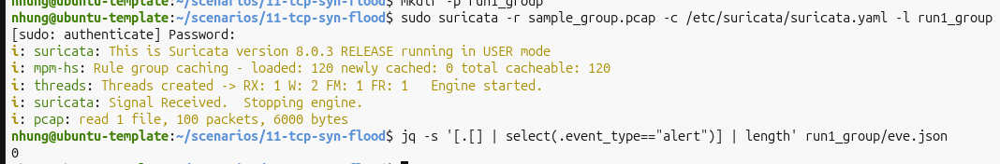
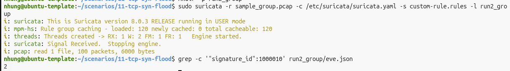
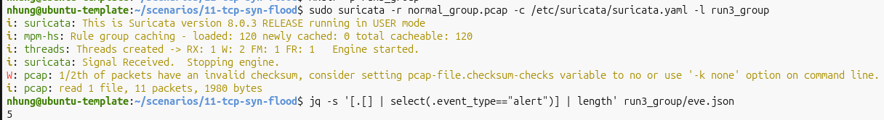
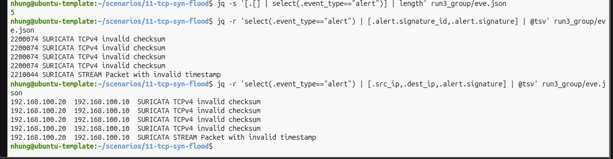
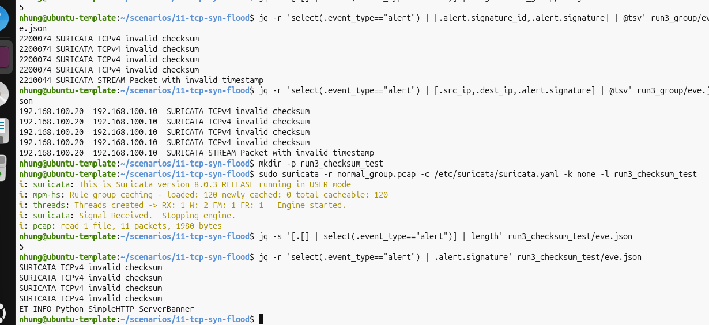
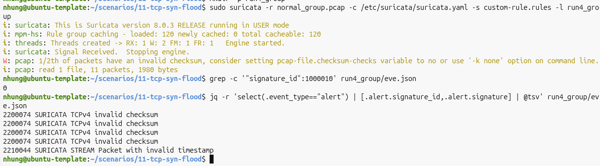

> **Hướng dẫn người đọc:** README này mô tả mục tiêu, môi trường, thứ tự tái lập và cách kiểm tra kết quả. Hãy đọc phần môi trường và lệnh trước khi chạy script; cập nhật IP/interface theo lab của bạn. Chỉ chạy trong mạng ảo được phép.

# Kịch bản 11 – Kiểm thử phát hiện lưu lượng TCP SYN tần suất cao bằng Suricata

## 1. Mục tiêu và phạm vi

Thực nghiệm trong mạng lab VMware Host-only do nhóm kiểm soát nhằm so sánh: (1) bộ luật mặc định của Suricata (đã cấu hình trên Victim; có các signature Emerging Threats) và (2) chính bộ luật đó **kết hợp luật tùy chỉnh** SID `1000010`. Không dùng file luật tự viết trên GitHub làm đại diện cho ET Open.

Đây là bài kiểm thử **dấu hiệu SYN tần suất cao**, chưa chứng minh tình trạng cạn bảng kết nối hay DoS thực tế. Mọi gói tin đều tạo trong mạng lab giới hạn.

## 2. Bài toán xây dựng luật riêng

**Bối cảnh.** Với mẫu SYN đã tạo, bộ luật đối chứng không phát sinh cảnh báo. Mục tiêu là có cơ chế ngưỡng bổ sung theo IP nguồn, đồng thời không cảnh báo bởi SID riêng trên một phiên HTTP bình thường.

- Đầu vào: PCAP chứa lưu lượng TCP có dấu SYN, IP nguồn `192.168.100.10`, IP đích `192.168.100.20`, cổng TCP `80`.
- Điều kiện luật: gói SYN hướng `to_server`, theo dõi bởi IP nguồn, `count 50`, `seconds 2`.
- Đầu ra: sự kiện alert với SID `1000010` nếu điều kiện luật/ngưỡng được thỏa; số cảnh báo phụ thuộc cơ chế threshold của Suricata, không đồng nghĩa số cuộc tấn công.
- Tiêu chí: quan sát alert trên mẫu SYN tần suất cao và không có alert SID `1000010` trên một kết nối HTTP bình thường.

**Chú ý:** `threshold: type threshold` điều tiết tần suất sinh alert. Không được đồng nhất số alert với số gói vượt ngưỡng hoặc gọi đây là thuật toán đếm SYN half-open.

## 3. Môi trường và cấu hình mạng

| Thành phần | Attacker | Victim |
|---|---|---|
| IP Host-only VMnet1 (`ens37`) | `192.168.100.10/24` | `192.168.100.20/24` |
| NAT (`ens33`) | Giữ để cập nhật | Giữ để cập nhật |
| Vai trò | Tạo lưu lượng SYN, gửi HTTP | Ghi PCAP, chạy Suricata 8.0.3 |

Cả hai card `ens37` kết nối **cùng VMnet1** với subnet `192.168.100.0/24`; không đặt gateway trên `ens37`. IP được đặt tĩnh bằng NetworkManager. Kiểm tra trên Victim/Attacker:

```bash
ip -br addr
ping -c 4 -I 192.168.100.10 192.168.100.20  # chạy từ Attacker
```



## 4. Xác minh bộ luật đối chứng trên Victim

Bộ luật đối chứng được nạp từ `suricata.yaml` qua `default-rule-path: /var/lib/suricata/rules` và `rule-files: - suricata.rules`. Trước khi thực nghiệm, kiểm tra không trộn ba SID tự viết vào file luật chung:

```bash
suricata-update --version
grep '^default-rule-path:' /etc/suricata/suricata.yaml
grep -n -A 2 '^rule-files:' /etc/suricata/suricata.yaml
grep -nE 'sid:(1000006|1000010|1000015);' /var/lib/suricata/rules/suricata.rules
sudo suricata -T -v -c /etc/suricata/suricata.yaml
sha256sum /var/lib/suricata/rules/suricata.rules
```

Tại lần xác minh của nhóm, Suricata báo **53.307 luật nạp thành công, 0 lỗi, 0 bỏ qua**; trong file luật có các chữ ký `ET`. Đây là bằng chứng về cấu hình nạp luật và sự hiện diện của chữ ký ET, không phải nhật ký đầy đủ về quá trình tải luật chính thức. Để tái hiện chính xác cần cố định cùng bộ luật và lưu SHA-256 tại thời điểm chạy.

## 5. File luật tùy chỉnh

`custom-rule.rules`:

```suricata
alert tcp 192.168.100.10 any -> 192.168.100.20 80 (flow:to_server; flags:S; msg:"NHOM_CANH_BAO: Phat hien tan cong TCP SYN Flood!"; threshold: type threshold, track by_src, count 50, seconds 2; classtype:denial-of-service; sid:1000010; rev:2;)
```

Luật giới hạn IP/cổng của lab; `flow:to_server` làm rõ hướng và tránh cảnh báo cú pháp SYN-only trước đó. `rev:2` là bản trình bày đã bổ sung hướng so với `rev:1` ban đầu. Kiểm tra:

```bash
cd ~/scenarios/11-tcp-syn-flood
sudo suricata -T -c /etc/suricata/suricata.yaml -s custom-rule.rules
```



## 6. Chuẩn bị lưu lượng và ghi PCAP

### 6.1. Mẫu SYN tần suất cao `sample_group.pcap`

**Victim, Terminal ghi:**

```bash
cd ~/scenarios/11-tcp-syn-flood
sudo tcpdump -i ens37 -nn -w sample_group.pcap 'tcp and src host 192.168.100.10 and dst host 192.168.100.20 and dst port 80'
```

**Attacker (chỉ trong mạng lab):**

```bash
sudo hping3 -I ens37 -S -c 100 -i u10000 -p 80 -s 40000 192.168.100.20
```

Hoặc chạy `./attack.sh` trên Attacker (sau khi chép script sang máy này). Dừng `tcpdump` trên Victim bằng `Ctrl+C`, xác minh:

```bash
tcpdump -nn -r sample_group.pcap -c 5
tcpdump -nn -r sample_group.pcap 'tcp[13] & 18 == 2' 2>/dev/null | wc -l
```

Mẫu thực nghiệm ghi được **100 gói SYN**, nguồn `192.168.100.10`, đích `192.168.100.20:80`. Máy đích không có dịch vụ LISTEN tại cổng 80 trong phép thử này, nên không suy luận rằng đã hình thành các kết nối half-open.



### 6.2. Mẫu HTTP bình thường `normal_group.pcap`

**Victim, Terminal 1:** tạo thư mục HTTP lab không chứa file cá nhân; có thể chạy `./http-server.sh`:

```bash
mkdir -p ~/kb11-http-lab
printf 'KB09 test\n' > ~/kb11-http-lab/index.html
cd ~/kb11-http-lab
sudo python3 -m http.server 80 --bind 192.168.100.20
```

**Victim, Terminal 2:**

```bash
cd ~/scenarios/11-tcp-syn-flood
sudo tcpdump -i ens37 -nn -w normal_group.pcap 'tcp and host 192.168.100.10 and host 192.168.100.20 and port 80'
```

**Attacker:**

```bash
curl --interface 192.168.100.10 http://192.168.100.20/
```

Dừng `tcpdump` và HTTP server bằng `Ctrl+C`; xem PCAP:

```bash
tcpdump -nn -r normal_group.pcap -c 15
```

Mẫu ghi nhận **11 gói TCP**, có bắt tay SYN → SYN-ACK → ACK, yêu cầu HTTP GET và phản hồi HTTP 200 OK. Đây là mẫu **HTTP một phiên**, không đại diện mọi lưu lượng bình thường.



## 7. Các lần kiểm thử Suricata

Tất cả chạy trên **Victim**, cùng bộ luật mặc định. Trong Run 2/4, tham số `-s custom-rule.rules` nạp **bổ sung** luật riêng vào bộ luật cấu hình; không phải thay thế ET Open. Mỗi thư mục log phải mới/trống để tránh cộng dồn `eve.json`.

### Run 1 – SYN + luật đối chứng

```bash
mkdir -p run1_group
sudo suricata -r sample_group.pcap -c /etc/suricata/suricata.yaml -l run1_group
jq -s '[.[] | select(.event_type=="alert")] | length' run1_group/eve.json
```

**Quan sát:** 100 gói, **0 alert**.



### Run 2 – SYN + luật riêng SID 1000010

```bash
mkdir -p run2_group
sudo suricata -r sample_group.pcap -c /etc/suricata/suricata.yaml -s custom-rule.rules -l run2_group
jq -s '[.[] | select(.event_type=="alert" and .alert.signature_id==1000010)] | length' run2_group/eve.json
```

**Quan sát:** 100 gói, **2 alert SID 1000010**.



### Run 3 – HTTP bình thường + luật đối chứng

```bash
mkdir -p run3_group
sudo suricata -r normal_group.pcap -c /etc/suricata/suricata.yaml -l run3_group
jq -s '[.[] | select(.event_type=="alert")] | length' run3_group/eve.json
jq -r 'select(.event_type=="alert") | [.alert.signature_id,.alert.signature] | @tsv' run3_group/eve.json
```

**Quan sát:** 11 gói, **5 alert**, gồm **4 × SID 2200074** (`TCPv4 invalid checksum`) và **1 × SID 2210044** (`STREAM Packet with invalid timestamp`). Đây là các cảnh báo giao thức, **không phải SYN Flood**.





### Kiểm tra checksum bổ sung (không thay thế Run 3)

```bash
mkdir -p run3_checksum_test
sudo suricata -r normal_group.pcap -c /etc/suricata/suricata.yaml -k none -l run3_checksum_test
jq -r 'select(.event_type=="alert") | .alert.signature' run3_checksum_test/eve.json
```

**Quan sát:** vẫn 5 alert, gồm **4 cảnh báo invalid checksum** và **1 cảnh báo ET INFO Python SimpleHTTP ServerBanner**. `-k none` không loại bỏ nhất thiết các signature kiểm tra checksum riêng và có thể thay đổi hướng giải mã luồng. Đây là phép kiểm tra phụ, **không được sửa số liệu Run 3 thành 0**.



### Run 4 – HTTP bình thường + luật riêng

```bash
mkdir -p run4_group
sudo suricata -r normal_group.pcap -c /etc/suricata/suricata.yaml -s custom-rule.rules -l run4_group
jq -s '[.[] | select(.event_type=="alert" and .alert.signature_id==1000010)] | length' run4_group/eve.json
jq -r 'select(.event_type=="alert") | [.alert.signature_id,.alert.signature] | @tsv' run4_group/eve.json
```

**Quan sát:** **0 alert riêng SID 1000010**, nhưng **5 alert giao thức khác** như Run 3.



## 8. Bảng tổng hợp và đánh giá

| Run | PCAP | Bộ luật chạy | Tổng alert | Alert SID 1000010 |
|---|---|---|---:|---:|
| 1 | SYN (100 gói) | Mặc định | 0 | — |
| 2 | SYN (100 gói) | Mặc định + custom | 2 | **2** |
| 3 | HTTP (11 gói) | Mặc định | **5** | — |
| 4 | HTTP (11 gói) | Mặc định + custom | **5** | **0** |

**Nhận xét.** Luật riêng phát sinh alert trên mẫu SYN tần suất cao và không phát sinh alert riêng trên mẫu HTTP một phiên. Không thể tính độ chính xác tổng thể, FPR/TPR đáng tin cậy chỉ từ hai PCAP ngắn. Run 3/4 có cảnh báo checksum/timestamp do bộ luật mặc định, cần báo cáo tách biệt. Không khẳng định 2 alert đồng nghĩa 2 cuộc tấn công, cũng không khẳng định đã gây DoS thực tế.

## 9. Cấu trúc file và cách chạy script

```text
11-syn-flood/
├── README.md
├── custom-rule.rules
├── attack.sh               # Attacker: 100 SYN qua ens37
├── normal.sh               # Attacker: HTTP request
├── http-server.sh          # Victim: server HTTP lab tối giản
├── capture.sh              # Victim: ./capture.sh syn | normal
├── run-tests.sh            # Victim: cần 2 PCAP, tạo thư mục log mới
├── .gitignore
└── *.png                   # ảnh bằng chứng, cùng cấp với README
```

**Cách dùng:** Sau khi chuyển các script phù hợp lên từng máy và cấp quyền `chmod +x *.sh`, trên Victim chạy `./capture.sh syn`, trên Attacker chạy `./attack.sh`, dừng bắt gói; tương tự dùng `./http-server.sh`, `./capture.sh normal`, `./normal.sh`. Sau khi có hai PCAP chạy `./run-tests.sh` trên Victim. Khi chạy lại, kết quả có thể thay đổi; không khẳng định script đã được kiểm thử thay cho các lệnh Terminal gốc. Các ảnh/số liệu trên là từ lần thực nghiệm thực tế đã ghi nhận trong cuộc làm việc.

**Lưu ý GitHub:** PCAP và log có thể lớn/chứa dữ liệu mạng, nên `.gitignore` bỏ qua chúng. Hai file PCAP mới được lưu trên Victim và không có sẵn trong gói ZIP này. Các ảnh PNG và README nằm cùng thư mục; liên kết ảnh không dùng tiền tố `images/`.


## Tệp nguồn và minh chứng gốc

Thư mục nguồn trong repository ban đầu: [`11-syn-flood`](https://github.com/phanyen206/Suricata/tree/main/scenarios/11-syn-flood). Các tệp nhị phân như PCAP, ảnh chụp, gói minh chứng hoặc tài liệu DOCX (nếu có) hiện vẫn được giữ tại repository nguồn; README này liên kết về nguồn để người đọc tải/xem, không thay thế bằng dữ liệu giả.
